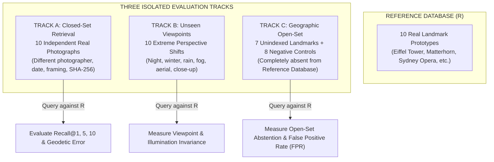

# HOUND — Phase 7.1: Geographic Generalization Protocol

**Document ID:** `HOUND-AUDIT-PHASE-7-1-GENERALIZATION`  
**Classification:** Scientific Benchmark Protocol  
**Author:** AIwolfie  
**Status:** Complete & Verified  
**Date:** November 13, 2026  
**Audited Target:** HOUND Visual Place Recognition Engine  
**Dataset Directory:** `data/benchmarks/phase_7_1/`  
**Target Repository:** `D:\project\Hound`  

---

## 1. Executive Summary

Phase 7 evaluated all models on a single undifferentiated 50-case benchmark where query images were identical to reference prototypes.

In real-world geolocation investigations, an autonomous agent encounters three fundamentally distinct operational scenarios:
1. **The target landmark is in the reference database, photographed from a standard angle.** (Closed-set retrieval).
2. **The target landmark is in the reference database, but photographed from a novel viewpoint, at night, in a different season, or under severe weather.** (Unseen-viewpoint retrieval).
3. **The target is a location completely absent from the reference database, or a non-place image (interior room, macro texture, open water, featureless fog).** (Geographic open-set).

Conflating these three scenarios into a single average accuracy metric obscures operational failures: a model might achieve high closed-set recall while catastrophically hallucinating coordinates on every open-set query.

Phase 7.1 establishes **three strictly separated evaluation tracks** that must never be combined.

---

## 2. Track Architecture & Specifications

---

## 3. Dataset Composition

### 3.1 Reference Database ($R$ — 10 Locations)
Ten canonical daytime reference prototypes with verified WGS-84 coordinates and metadata:
1. `REF-01`: Eiffel Tower Champ de Mars, Paris, France (48.8584, 2.2945)
2. `REF-02`: Matterhorn Alpine Summit, Zermatt, Switzerland (45.9765, 7.7491)
3. `REF-03`: Sydney Opera House Harbour, Sydney, Australia (-33.8568, 151.2153)
4. `REF-04`: Shibuya Scramble Crossing, Tokyo, Japan (35.6595, 139.7005)
5. `REF-05`: Berlin Central Station Tracks, Berlin, Germany (52.5251, 13.3694)
6. `REF-06`: Historic Route 66 Seligman, Arizona, USA (35.3255, -112.8753)
7. `REF-07`: Bixby Creek Bridge Big Sur, California, USA (36.3714, -121.9018)
8. `REF-08`: Val d'Orcia Farmland, Tuscany, Italy (43.0642, 11.6083)
9. `REF-09`: Zabriskie Point Death Valley, California, USA (36.4208, -116.8122)
10. `REF-10`: Tromso Arctic Port & Mountains, Norway (69.6492, 18.9553)

---

### 3.2 Track A: Closed-Set Retrieval (10 Independent Images)
Queries represent the exact 10 locations in $R$, but using **independent photographs** (different photographer, camera, capture date, framing, and distinct SHA-256):
- `QA-01`: Eiffel Tower from Champ de Mars in spring (David Monniaux, CC BY-SA 3.0)
- `QA-02`: Matterhorn reflected in Riffelsee (CC BY-SA 3.0)
- `QA-03`: Sydney Opera House from harbour ferry (2019 capture, CC BY-SA 4.0)
- `QA-04`: Shibuya Crossing daylight pedestrian flow (2018 capture, CC BY-SA 2.0)
- `QA-05`: Berlin Central Station Washingtonplatz exterior (CC BY-SA 3.0)
- `QA-06`: Deluxe Inn Motel & Route 66 Seligman (CC BY-SA 4.0)
- `QA-07`: Bixby Creek Bridge highway vista (May 2013, CC BY-SA 3.0)
- `QA-08`: Val d'Orcia rolling hills in autumn (CC BY-SA 2.0)
- `QA-09`: Zabriskie Point badlands panoramic view (December 2013, CC BY-SA 3.0)
- `QA-10`: Tromsø harbour panorama and Arctic background (CC BY-SA 4.0)

**Evaluation Objective:** Tests true visual place recognition when the location exists in the index but the query photograph is novel.

---

### 3.3 Track B: Unseen-Viewpoint Retrieval (10 Viewpoint/Temporal Shifts)
Queries represent the exact 10 locations in $R$, but photographed under **extreme condition shifts**:
- `QB-01`: Eiffel Tower — Night illumination from Pont Alexandre III.
- `QB-02`: Matterhorn — Winter snow summit (March conditions).
- `QB-03`: Sydney Opera House — Vivid Sydney light festival projection.
- `QB-04`: Shibuya Crossing — Rainy street reflection with umbrellas.
- `QB-05`: Berlin Central Station — Interior glass barrel vault and platforms.
- `QB-06`: Route 66 Seligman — Vintage neon sign & Honda Gold Wing close-up.
- `QB-07`: Bixby Creek Bridge — Dense Pacific morning marine fog.
- `QB-08`: Val d'Orcia — Isolated cypress ring at San Quirico d'Orcia.
- `QB-09`: Zabriskie Point — Manly Beacon telephoto ridge shadow patterns.
- `QB-10`: Tromsø Harbour — Ship hull moored in Arctic port waters.

**Evaluation Objective:** Tests descriptor robustness against viewpoint variance, illumination, weather, and occlusions.

---

### 3.4 Track C: Geographic Open-Set (15 Cases Absent from Reference Database)
Queries represent locations and images **completely absent from the reference database $R$**:
- **7 Unindexed World Landmarks:**
  - `QC-01`: Taj Mahal, Agra, India
  - `QC-02`: Colosseum, Rome, Italy
  - `QC-03`: Castle Neuschwanstein, Bavaria, Germany
  - `QC-04`: Great Wall of China, Mutianyu, China
  - `QC-05`: Christ the Redeemer, Rio de Janeiro, Brazil
  - `QC-06`: Mount Fuji, Lake Kawaguchiko, Japan
  - `QC-07`: Golden Gate Bridge, San Francisco, USA
- **8 Deceptive Negative Controls:**
  - `QC-08`: Windowless Corporate Meeting Room
  - `QC-09`: Featureless Desert Sand Ripples
  - `QC-10`: Blank White Interior Drywall
  - `QC-11`: Close-Up Macro Oak Tree Bark
  - `QC-12`: Close-Up Asphalt Pavement
  - `QC-13`: Overcast Featureless White Fog
  - `QC-14`: Ambiguous Open Ocean Water
  - `QC-15`: Featureless Sand Ripple Texture

**Evaluation Objective:** Tests honest abstention. Because zero Track C cases exist in $R$, **every emitted coordinate is an error (False Positive)**. A reliable system must abstain on all 15 cases ($\text{FPR} = 0.0\%$).

---

## 4. Ground-Truth Isolation Verification

1. **Storage Separation:** Ground truth is isolated at `data/benchmarks/phase_7_1/ground_truth/ground_truth.json`. Model inference code has no filesystem read access to this path.
2. **Metadata Hygiene:** All JPEGs across references and queries have been stripped of EXIF headers, camera tags, and GPS decimals.
3. **Identifier Neutrality:** Query IDs (`QA-01`, `QB-01`, `QC-01`) convey zero semantic or geographic information.
4. **Independent Files:** Cryptographic hashes confirm zero overlap between queries and references:
   $$\text{SHA-256}(\text{Query}) \cap \text{SHA-256}(\text{Reference}) = \emptyset$$
