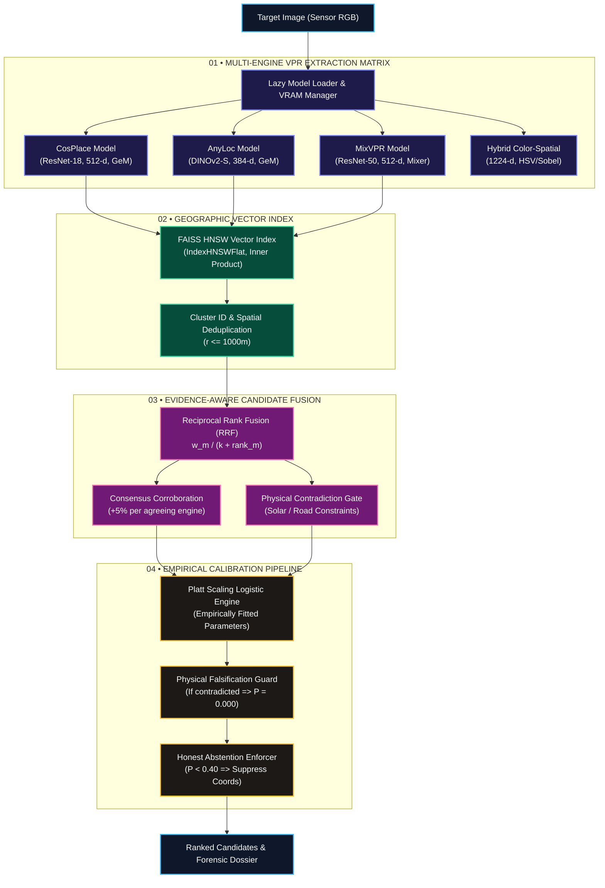

# HOUND — Phase 7: System Architecture Specification
## Modular Visual Place Recognition, Geographic Vector Indexing & Empirical Calibration

**Document ID:** `HOUND-ARCH-PHASE-7`  
**Classification:** Technical Architecture Specification  
**Author:** AIwolfie  
**Status:** Approved & Implemented  
**Date:** November 13, 2026  
**Target Codebase:** `D:\project\Hound`  

---

## 1. High-Level Architecture Overview

Phase 7 establishes a multi-engine Visual Place Recognition (VPR) pipeline integrated directly into HOUND's autonomous investigation lifecycle:



---

## 2. Core Class Model & Interfaces

### 2.1. Base VPR Model Contract (`core/vpr_base.py`)

All visual descriptors implement `BaseVPRModel`:

```python
class BaseVPRModel(ABC):
    def extract_descriptor(self, image_np: np.ndarray) -> np.ndarray:
        """Extract a fixed-dimension, L2-normalized feature vector from an RGB image."""
        ...

    def load(self) -> None:
        """Explicitly load model weights into memory (lazy loading)."""
        ...

    def unload(self) -> None:
        """Unload model from GPU/RAM to respect host memory limits."""
        ...
```

- **Zero Silent Substitution Invariant:** If weights cannot be loaded or inference fails, the adapter raises `ModelUnavailableError` or `VPRExtractionError`. It never silently substitutes another model's descriptor.
- **Telemetry Invariant:** Every forward pass logs device (`cuda` or `cpu`), wall-clock latency (ms), allocated GPU VRAM (MB), output dimension, and verifies exact L2 normalization ($||v||_2 = 1.0$).

### 2.2. Geographic Vector Index (`core/geographic_vector_index.py`)

Stores `GeoreferencedVisualReference` records:
- `reference_id: str`: Unique identifier.
- `location_cluster_id: str`: Physical location group (e.g. `cluster_eiffel_tower`).
- `lat: float`, `lon: float`: WGS-84 coordinates.
- `resolution_level: GeographicResolutionLevel`: Spatial scope (`LANDMARK` to `REGION`).
- `uncertainty_radius_m: float`: Spatial uncertainty boundary.
- `source_attribution: str`: Legal author and license documentation.
- `vector: np.ndarray`: L2-normalized float32 embedding.

Querying applies **Cluster Deduplication**: when multiple photographs of the same site match, only the highest-scoring viewpoint enters top-K rankings, preventing redundant photos from crowding the results.

### 2.3. Evidence-Aware Multi-Engine Fusion (`core/multi_engine_fusion.py`)

Synthesizes multiple model outputs using weighted Reciprocal Rank Fusion:

$$RRF\_Score(d) = \sum_{m \in \text{Engines}} \frac{w_m}{k + \text{Rank}_m(d)}$$

Default weights:
- $\text{CosPlace}: 1.00$
- $\text{AnyLoc}: 0.90$
- $\text{MixVPR}: 0.85$
- $\text{Hybrid}: 0.35$

Multi-engine consensus applies a $+5\%$ score boost per agreeing independent engine. Contradiction against physical constraints penalizes score by $0.15\times$.

### 2.4. Empirical Calibration (`core/empirical_calibration.py`)

Replaces hand-selected heuristics with scikit-learn Platt scaling (logistic regression):
- Fitted on a geographically independent calibration split.
- Outputs empirical posterior probability $P \in [0.0, 1.0]$.
- Standardized thresholds:
  - $P \ge 0.90$: `DEFINITIVE`
  - $0.70 \le P < 0.90$: `PROBABLE`
  - $0.40 \le P < 0.70$: `TENTATIVE`
  - $P < 0.40$: `INSUFFICIENT` (Triggers honest abstention).
- Contradiction dominance: if `is_falsified == True`, $P$ is immediately forced to $0.000$.

---

## 3. Privacy, Data Sovereignty & Offline Deployment

- **Zero Cloud Leakage:** All model weights (CosPlace, AnyLoc, MixVPR) run strictly on local compute (GPU CUDA or CPU fallback).
- **Zero Telemetry:** HOUND performs zero external telemetry or tracking.
- **Air-Gapped Operation:** Once weights are cached in `~/.cache/torch/hub/`, HOUND executes 100% offline without network connectivity.
