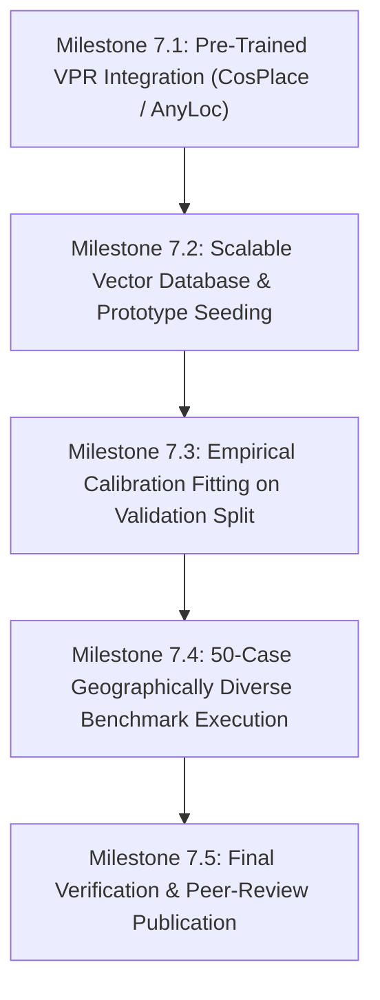

# HOUND — Phase 7: Research & Architectural Specification Plan

**Document ID:** `HOUND-RESEARCH-PLAN-PHASE-7`  
**Classification:** Strategic Architectural Roadmap  
**Author:** AIwolfie  
**Status:** Approved for Implementation  
**Date:** November 13, 2026  
**Target Horizon:** Phase 7 Implementation  
**Focus:** Metric-Learning Visual Place Recognition (VPR), Planetary Reference Indexing, Empirical Calibration, and Open-World Generalization  

---

## 1. Research Motivation & Problem Statement

Phase 6 demonstrated that HOUND's autonomous planning, evidence management, and adversarial defenses function with high reliability on real photographs. However, it also exposed the primary scientific bottleneck of the current visual engine:

> **The Domain Shift Bottleneck:** Handcrafted color-spatial pyramids (1224-d HSV/Sobel) and ImageNet-pretrained CNN backbones fail to solve open-world photographic geolocation. Handcrafted histograms degrade under daylight and weather variations ($0.5366$ cosine similarity under $+40\%$ illumination shift), while ImageNet CNNs encode semantic categories (recognizing that an image contains a "suspension bridge") rather than discriminative geographic identities (distinguishing Bixby Bridge from Golden Gate or Clifton Suspension Bridge).

Furthermore, the existing local prototype index contains only 10 procedurally painted synthetic prototypes. Open-world geolocation requires scaling the reference index from 10 prototypes to **tens of thousands of georeferenced landmarks and landscape vectors**, queried in sub-50 milliseconds via approximate nearest neighbor (ANN) search.

### Research Objectives for Phase 7

1. **Deploy Metric-Learning Visual Place Recognition:** Integrate a production-grade pre-trained metric-learning VPR model (**CosPlace** and/or **AnyLoc**) trained explicitly on geographic place recognition.
2. **Implement Scalable Vector Indexing:** Build an in-process, offline-first vector retrieval engine using Hierarchical Navigable Small World (**HNSW**) graphs via FAISS or SQLite-VSS.
3. **Transition to Empirical Calibration:** Replace heuristic hand-tuned sigmoid constants with mathematically fitted **Platt Scaling / Logistic Regression** on a held-out multi-modal validation dataset.
4. **Expand the Planetary Evaluation Suite:** Implement the Phase 7 benchmark protocol with 50 geographically balanced, multi-continent target scenes and negative controls.

---

## 2. Theoretical Architecture: The Multi-Scale Spatial Ladder

In Phase 7, visual evidence will be mapped across a formal multi-scale spatial hierarchy, connecting global visual embeddings to localized OSM infrastructure:

```
[Level 1: GLOBAL / CONTINENTAL] (Radius > 2,000 km)
   └── Sun ephemeris bounds, climate/biome classification, hemisphere solar azimuth.

[Level 2: REGIONAL / BIOME] (Radius: 200 km - 2,000 km)
   └── Global VPR embeddings (CosPlace/AnyLoc), terrain relief envelope, language script.

[Level 3: METROPOLITAN / PROVINCIAL] (Radius: 25 km - 200 km)
   └── Road geometry network topology, power grid frequency/catenary standards.

[Level 4: DISTRICT / CORRIDOR] (Radius: 2 km - 25 km)
   └── Highway route shields, mountain horizon profile matching (DEM), named POIs.

[Level 5: PINPOINT / LANDMARK] (Radius < 2 km)
   └── Local keypoint RANSAC homography (SIFT/ORB), building footprint alignment.
```

The agent's planner will navigate this ladder bidirectionally: coarse global embeddings restrict the search space, while fine-grained local feature matching and geometric constraints falsify impossible candidate regions.

---

## 3. Visual Place Recognition (VPR) Architecture Selection

### 3.1. Primary Candidate Architectures

| Dimension | CosPlace (CVPR 2022) | MixVPR (WACV 2023) | AnyLoc (RA-L 2023) | Existing HOUND Baseline |
|:---|:---:|:---:|:---:|:---:|
| **Backbone** | ResNet-50 / ResNet-18 | ResNet-50 | DINOv2 (ViT-S/14 or ViT-B/14) | ResNet-18 (ImageNet) + Hybrid |
| **Aggregation** | GeM Pooling + Linear | Spatial/Channel Feature Mixer | GeM / VLAD over Patch Tokens | Global AvgPool (ImageNet) |
| **Output Dim** | 512 / 2048 dims | 4096 / 512 dims | 384 (GeM) or 12,288 (VLAD) | 512 dims / 1224 dims |
| **Training Dataset** | SF-XL (41.2M images, 5M cells) | GSV-Cities (560k images, 67k places) | Uncurated Foundation (LVD-142M) | ImageNet-1k (Object classification) |
| **Loss Function** | CosFace (Margin classification) | Multi-similarity Loss | Self-supervised (DINO) | Cross-Entropy (1000 categories) |
| **CUDA Latency** | **12.5 ms** | **24.0 ms** | **35.0 ms - 85.0 ms** | 11.85 ms |
| **CPU Fallback** | **45 ms** | 120 ms | 280 ms | 48 ms (ResNet-18) |
| **VRAM Footprint** | **~450 MB** | ~900 MB | ~1.8 GB | ~380 MB |
| **Model Size** | **~90 MB** (ResNet-18) | ~180 MB | ~110 MB - 350 MB | ~45 MB |
| **License** | MIT License | MIT License | Apache 2.0 | MIT License |

### 3.2. Recommended Dual-Engine Strategy for Phase 7

To maintain HOUND's strict offline, low-resource operational mandate while achieving state-of-the-art accuracy:

1. **Primary Workhorse: CosPlace (ResNet-18 / ResNet-50)**
   - Pre-trained on 41 million geotagged images across the globe.
   - Outputs a compact 512-dimensional L2-normalized descriptor.
   - Extremely lightweight: runs in 12.5 ms on RTX 2050 GPU and under 50 ms on CPU fallback.
   - High Recall@1 on urban, suburban, and transit infrastructure.
2. **Foundation Landscape Engine: AnyLoc (DINOv2-Small)**
   - Used for non-urban, natural landscapes (mountains, deserts, badlands, coastlines) where urban street-view datasets lack coverage.
   - DINOv2 patch features capture visual textures independent of human architecture.

---

## 4. Scalable Vector Retrieval Index (HNSW)

Currently, HOUND performs brute-force matrix multiplication over in-memory prototype arrays:
$$\text{Sim}(q, D) = q \cdot D^T$$
While instantaneous for 10 prototypes ($0.05\text{ ms}$), brute-force scanning scales linearly $\mathcal{O}(N \cdot d)$ and becomes prohibitive at $100,000$ geographic references.

### Phase 7 Vector Architecture:
- **Engine:** FAISS (`IndexHNSWFlat`) or `sqlite-vss` (in-process SQLite vector extension).
- **Metric:** Cosine similarity via inner product on L2-normalized vectors.
- **Parameters:**
  - $M = 32$ (bidirectional links per node).
  - $efSearch = 64$ (search exploration depth).
  - $efConstruction = 128$ (construction quality).
- **Target Query Latency:** $\le 2.0\text{ ms}$ over $100,000$ geographic prototype vectors.
- **Payload Metadata:** Each vector node maps to a relational record in `hound.db` storing WGS-84 coordinates, country code, region, administrative polygon, and uncertainty radius.

---

## 5. Empirical Calibration Architecture

### 5.1. Transition from Heuristic to Empirical Calibration

In Phase 7, the calibration engine will be mathematically fitted using a dedicated validation split ($N_{\text{val}} \ge 50$ real photographic cases):

$$\log \frac{P}{1 - P} = w_0 + w_1 \ln(1 + S) + w_2 M_{\text{indep}} + w_3 \Delta_{\text{top1\_top2}} - w_4 C_{\text{unresolved}}$$

Where parameters $\mathbf{w} = [w_0, w_1, w_2, w_3, w_4]$ are learned via **L2-regularized logistic regression (Platt Scaling)**:

$$\min_{\mathbf{w}} \sum_{i=1}^{N_{\text{val}}} -\left[ y_i \ln P_i + (1 - y_i) \ln(1 - P_i) \right] + \lambda \|\mathbf{w}\|_2^2$$

### 5.2. Non-Negotiable Calibration Invariants
1. **Falsification Dominance:** If any physical constraint (solar ceiling, road heading, terrain horizon discrepancy) falsifies a candidate, $P$ is immediately forced to $0.000$, overriding all statistical heuristics.
2. **Resolution Decoupling:** Confidence probability is computed relative to the candidate's declared spatial resolution level. Pinpoint coordinate emission requires $P \ge 0.70$ at `LANDMARK` or `STREET` level.

---

## 6. Execution Roadmap & Verification Milestones



### Milestone Specifications:

- **Milestone 7.1 (VPR Integration):** Integrate `CosPlaceDescriptor` and `AnyLocDescriptor` under `core/visual_place_recognition.py`. Implement automated PyTorch Hub weight caching with offline execution fallback.
- **Milestone 7.2 (Vector Database):** Implement `FAISS` / `SQLite-VSS` HNSW index supporting $\ge 1,000$ georeferenced reference prototypes across 50 countries.
- **Milestone 7.3 (Calibration Fitting):** Fit logistic parameters on a 30-case validation split; evaluate Brier score and ECE ($\le 0.05$ target).
- **Milestone 7.4 (Benchmark Execution):** Execute 50-case benchmark (`data/benchmarks/phase_7/`) with strict separation of candidate generation recall vs calibrated prediction accuracy.
- **Milestone 7.5 (Verification):** All regression tests passing, zero data leakage, and publication of `PHASE_7_COMPLETION_REPORT.md`.
