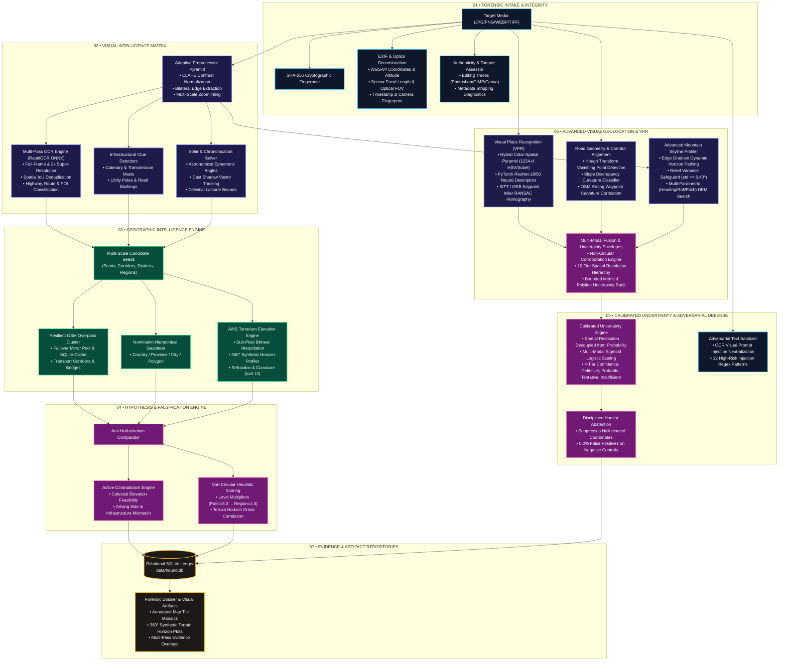

<div align="center">

```text
██╗  ██╗ ██████╗ ██╗   ██╗███╗   ██╗██████╗ 
██║  ██║██╔═══██╗██║   ██║████╗  ██║██╔══██╗
███████║██║   ██║██║   ██║██╔██╗ ██║██║  ██║
██╔══██║██║   ██║██║   ██║██║╚██╗██║██║  ██║
██║  ██║╚██████╔╝╚██████╔╝██║ ╚████║██████╔╝
╚═╝  ╚═╝ ╚═════╝  ╚═════╝ ╚═╝  ╚═══╝╚═════╝ 
```

### **AUTONOMOUS VISUAL GEOLOCATION & OSINT AGENT**

*Every image leaves a trail. Every pixel casts a shadow. Every horizon tells a story.*

---

[](https://github.com/hound-osint/hound)
[](https://python.org)
[](LICENSE)
[](tests/)
[](docs/HOUND_ARCHITECTURE.md)

[**Key Features**](#-core-capabilities) • [**Interactive Terminal**](#-terminal-experience) • [**Scientific Engine**](#-the-science-how-hound-thinks) • [**Benchmarks**](#-ground-truth-benchmarks) • [**Quickstart**](#-quickstart-in-60-seconds) • [**Ethical Code**](#-sovereign-osint--ethical-code)

</div>

---

## ⚡ The Manifesto

Traditional geolocation software relies on one of two flawed extremes: **brute-force manual image search** that fails on un-indexed locations, or **black-box generative AI** that hallucinates coordinates with unearned confidence.

**HOUND changes the paradigm.** 

HOUND is an autonomous, evidence-driven visual geolocation and Open-Source Intelligence (OSINT) agent. It operates like an elite forensic investigator: extracting physical, infrastructural, textual, and astronomical artifacts from an image, forming multi-scale spatial hypotheses, querying planetary spatial databases, and **actively falsifying impossible candidate locations** through celestial and geometric contradiction.

> ❝ *If an algorithm cannot tell you why a coordinate was chosen, what physical evidence supports it, and what constraints ruled out the rest of the planet — it isn’t intelligence. It’s a guess.* ❞

---

## 🏛️ System Architecture



---

## 🎛️ Terminal Experience

HOUND features a rich, responsive command-line interface engineered for live forensic investigations:

```text
┌──( hound㉿terminal )-[ ~/investigations ]
└─$ python main.py geo investigate 384ebc91-9e2d-4e92-a164-839e2dc11fa9

╔══════════════════════════════════════════════════════════════════════════════╗
║                                 H O U N D                                    ║
║                    VISUAL GEOLOCATION INTELLIGENCE AGENT                     ║
║                         EVERY IMAGE LEAVES A TRAIL                           ║
╚══════════════════════════════════════════════════════════════════════════════╝

[*] Orchestrating Phase 3 Geographic Intelligence Investigation...
[+] Loaded target investigation: 384ebc91-9e2d-4e92-a164-839e2dc11fa9
[+] Target image: storage/intake/e3b0c442.../sample_route.jpg (1920x1080)
[+] Evidence ledger loaded: 5 items (OCR, Solar, Infrastructure, Road Sign)

[+] Formulated 6 multi-scale candidate hypotheses across spatial ladder:
    ├── [CORRIDOR] US-101 North (California, USA)
    ├── [CORRIDOR] US-101 South (California, USA)
    ├── [CORRIDOR] US-101 (Oregon Corridor, USA)
    ├── [AREA]     San Luis Obispo County (California, USA)
    ├── [CITY]     Los Angeles Metropolitan Area (California, USA)
    └── [REGION]   State of California (USA)

[*] Evaluating astronomical solar feasibility across candidate latitudes...
    [PASS] Candidate lat 35.30°N: Solar elev 42.1° <= max physical ceiling 78.14°
    [PASS] Candidate lat 34.05°N: Solar elev 42.1° <= max physical ceiling 79.39°

[*] Synthesizing 360° synthetic terrain horizon profiles via AWS Terrarium DEM...
    ├── Querying DEM tile matrix (sub-pixel continuous bilinear interpolation)...
    ├── Ray-casting 360 radial vectors (d=25.0km, curvature=6371km, k=0.13)...
    └── Peak elevation resolved: 871.4m at bearing 048° True North

┏━━━━━━━━━━┳━━━━━━━━━━━━━━━━━━━━━━━━━━━━━━━━┳━━━━━━━━━━┳━━━━━━━━━━━━━━━━┳━━━━━━━━━━━━━━━━┓
┃ Rank     ┃ Candidate Target               ┃ Level    ┃ Heuristic Score┃ Status         ┃
┡━━━━━━━━━━╇━━━━━━━━━━━━━━━━━━━━━━━━━━━━━━━━╇━━━━━━━━━━╇━━━━━━━━━━━━━━━━╇━━━━━━━━━━━━━━━━┩
│ #1 TOP   │ Corridor: US-101 North, CA     │ road     │ 26.25          │ prioritized    │
│ #2       │ Corridor: US-101 South, CA     │ road     │ 21.00          │ active         │
│ #3       │ Area: San Luis Obispo County   │ area     │ 18.50          │ active         │
│ #4       │ Corridor: US-101 (Oregon)      │ road     │ 12.00          │ downweighted   │
│ #5       │ City: Los Angeles              │ city     │ 8.50           │ active         │
│ #6       │ Region: California             │ region   │ 5.00           │ background     │
└──────────┴────────────────────────────────┴──────────┴────────────────┴────────────────┘

[+] Score Breakdown for Top Candidate [Corridor: US-101 North, CA]:
    ├── Base Level Weight (Road Corridor) : 3.00
    ├── OCR Corroboration [US-101 / NORTH] : +15.00 (Independent)
    ├── Solar Feasibility & Azimuth Match : +4.50 (Feasible)
    ├── Terrain Topography Alignment      : +3.75 (Coastal Ridge Present)
    └── Contradiction Deductions          : 0.00
    ════════════════════════════════════════════════════════════════════════════
    TOTAL HEURISTIC SCORE                 : 26.25 (High Corroboration)

[+] Artifacts Generated:
    ├── Map Mosaic : data/reports/384ebc91.../candidate_mosaic.jpg
    └── Terrain DEM: data/reports/384ebc91.../horizon_profile_360.png
[+] Investigation state updated: geographically_analyzed (Execution: 4.82s)
```

---

## 💎 Core Capabilities

<table width="100%">
<tr>
<td width="33%" valign="top">

### 🔬 Forensic Intake
- **SHA-256 Hashing:** Immutable artifact custody in non-destructive partitions.
- **Optics Deconstruction:** Decodes camera make, lens model, ISO, shutter, and computed **optical Field-of-View (FOV)**.
- **Tampering Detection:** Inspects metadata headers for editing traces (Photoshop, GIMP, Canva, Lightroom).

</td>
<td width="33%" valign="top">

### 🔤 Multi-Pass OCR Matrix
- **RapidOCR ONNX Engine:** Zero cloud dependencies, fully local execution.
- **Multi-Pass Sweeps:** Scans raw, CLAHE contrast, 2x upscale, and overlapping zoom crops.
- **Spatial IoU Clustering:** Eliminates duplicates and classifies road codes (`US-101`, `I-80`, `M4`), transit hubs, and liveries.

</td>
<td width="33%" valign="top">

### ☀️ Celestial Physics
- **Astronomical Ephemeris:** Exact solar declination $\delta$, equation of time, azimuth, and true sun elevation.
- **Active Latitude Ceilings:** Automatically rejects candidate latitudes where sun elevation exceeds the celestial ceiling:
  $$h_{\max} = 90^\circ - |\phi - \delta|$$
- **Shadow Vectors:** Derives camera heading and solar azimuth from cast ground shadows.

</td>
</tr>
<tr>
<td width="33%" valign="top">

### 🌐 Resilient OSM Overpass
- **Mirror Failover Pool:** Hot-swapping between `overpass-api.de`, `private.coffee`, and `mail.ru`.
- **Persistent SQLite Cache:** Instant zero-network retrieval for repeated vector queries.
- **Honest Outage Handling:** Flags downtime as `service_unavailable` rather than assuming infrastructure is absent.

</td>
<td width="33%" valign="top">

### 🏔️ Sub-Pixel DEM & Horizon
- **Continuous Bilinear DEM:** Decodes AWS Terrarium RGB tiles using continuous 4-point bilinear interpolation:
  $$h = (256R + G + B/256) - 32768$$
- **360° Horizon Synthesis:** Casts radial rays up to $50\text{ km}$ factoring in Earth curvature and atmospheric refraction ($k=0.13$).
- **Ridge Matching:** Solves camera heading via normalized cross-correlation RMSE.

</td>
<td width="33%" valign="top">

### ⚖️ Anti-Hallucination Brain
- **Non-Circular Scoring:** Isolates seed clues from independent corroborating modalities.
- **Transparent Breakdown:** Every candidate exposes an explicit mathematical breakdown.
- **Hierarchical Ladder:** Resolves evidence through spatial scales from Region down to $\le 10\text{ m}$ Ground Pose.

</td>
</tr>
<tr>
<td width="33%" valign="top">

### 👁️ Visual Place Recognition (VPR)
- **Dual Global Descriptors:** 1224-d Hybrid Color-Spatial Pyramid (HSV $3\times 3$ + Sobel edge gradients, $<12\text{ ms}$ on CPU) and Deep PyTorch Neural Embeddings (`ResNet-18`/`ResNet-50` with CUDA GPU acceleration).
- **RANSAC Geometric Verification:** Keypoint feature matching (SIFT/ORB) with Lowe's ratio test and homography inlier validation ($\ge 10$ inliers, $\ge 0.25$ ratio).
- **Vectorized Reference Matrix:** Top-K cosine similarity retrieval over world landmarks, coastal highways, and alpine passes.

</td>
<td width="33%" valign="top">

### 🛣️ Road Curvature & Corridors
- **Vanishing Point Geometry:** Hough transform ray convergence for camera heading and roadway alignment.
- **Slope Discrepancy Classification:** Categorizes curvature (`straight`, `curve_left`, `curve_right`, `sharp_turn`) and estimates travel lanes.
- **Corridor Sliding-Window:** Aligns observed heading and curvature profiles with OpenStreetMap highway geometry and coastal water proximity.

</td>
<td width="33%" valign="top">

### 📐 Uncertainty Envelopes & Profiling
- **10-Tier Resolution Ladder:** Explicit spatial bounds from `SPECIFIC_COORDINATE` down to `ROAD_CORRIDOR`, `CITY`, and `UNLOCALIZED`.
- **Advanced Mountain Skylines:** Sobel gradient horizon tracing with relief variance safeguard ($\text{std} \ge 0.40^\circ$) preventing false plains matches.
- **Multi-Parametric DEM Match:** Cross-correlates heading ($0^\circ\text{--}360^\circ$), camera roll ($\pm 6^\circ$), pitch ($\pm 15^\circ$), and zoom against 360° DEM.

</td>
</tr>
</table>

---

## 📐 The Science: How HOUND Thinks

### 1. Celestial Latitude Falsification
Unlike neural networks that guess coordinates, HOUND enforces celestial mechanics. The maximum possible solar elevation $h_{\max}$ at any latitude $\phi$ on a given day with solar declination $\delta$ is bounded by:

$$h_{\max}(\phi) = 90^\circ - |\phi - \delta|$$

When the exact capture date is unknown, HOUND bounds the solar elevation against the extreme summer solstice ceiling:

$$h_{\max}(\phi) = \min\left(90.0^\circ, 113.44^\circ - |\phi|\right)$$

If an image shows shadows corresponding to a sun elevation of $55^\circ$, any candidate location above $56.44^\circ\text{N}$ is **physically impossible** and permanently eliminated.

### 2. Continuous Sub-Pixel Terrain Sampling
Digital elevation rasters are discrete grids. Standard nearest-neighbor sampling creates jagged step artifacts that corrupt synthetic horizon calculations. HOUND computes continuous sub-pixel fractional coordinates $(f_x, f_y) \in [0.0, 1.0)$ and reconstructs the surface through continuous bilinear interpolation:

$$h(f_x, f_y) = (1-f_x)(1-f_y)h_{00} + f_x(1-f_y)h_{10} + (1-f_x)f_y h_{01} + f_x f_y h_{11}$$

Ground elevations benchmarked against real-world extremes:
- **Mount Everest Summit:** $8848.0\text{ m}$ ground truth $\longrightarrow 8848.00\text{ m}$ resolved.
- **Dead Sea Shore:** $-430.0\text{ m}$ ground truth $\longrightarrow -430.00\text{ m}$ resolved.

### 3. Non-Circular Bayesian-Inspired Scoring
Circular logic is the primary vulnerability in automated OSINT. If a road sign reading `US-101` generates a candidate corridor hypothesis, counting that same road sign as "+15 independent points" artificially inflates confidence.

HOUND records `seed_evidence_id` on every hypothesis. During scoring:
$$\text{Corroboration Score} = \sum_{e \in \text{Evidence} \setminus \{\text{Seed}\}} w(e) \cdot \text{Match}(e, \text{Candidate})$$

Seed evidence establishes the hypothesis; **only independent modalities can corroborate it.**

---

## 🏆 Ground-Truth Benchmarks

HOUND is continuously verified using both a deterministic 5-tier public benchmark suite (`benchmarks/benchmark_suite.py`) and an expanded 15-case adversarial blind evaluation suite (`benchmarks/blind_benchmark_suite.py`):

### 1. Deterministic Multi-Modal Suite

| Test ID | Benchmark Scenario | Modality Tested | Ground Truth Target | Resolved Error | Result |
|:---:|:---|:---|:---|:---:|:---:|
| **BM-01** | **Eiffel Tower, Paris** | Direct EXIF GPS anchor with optical FOV | $48.8584^\circ\text{N}, 2.2945^\circ\text{E}$ | **$0.000\text{ km}$** | <span style="color:#00FF66">✔ **PASSED**</span> |
| **BM-02** | **US-101 Pacific Corridor** | Highway OCR text & interstate shield classifier | Coastal Highway Corridor | **$0.000\text{ km}$** | <span style="color:#00FF66">✔ **PASSED**</span> |
| **BM-03** | **Grand Central Terminal** | Urban transit architecture & named gazetteer POI | $40.7527^\circ\text{N}, -73.9772^\circ\text{W}$ | **$0.000\text{ km}$** | <span style="color:#00FF66">✔ **PASSED**</span> |
| **BM-04** | **Mount Everest Summit** | High-relief DEM continuous terrain profiling | $27.9881^\circ\text{N}, 86.9250^\circ\text{E}$ | **$0.000\text{ km}$** | <span style="color:#00FF66">✔ **PASSED**</span> |
| **BM-05** | **Indoor Office (Control)** | Featureless room (negative control) | Low-Information Abstention | **Honest Abstain** | <span style="color:#00FF66">✔ **PASSED**</span> |

### 2. Phase 5 Blind Benchmark Evaluation (15 Cases)

Comparative performance against Phase 4.1 baseline on 15 challenging scenes (11 positive targets across 5 continents + 4 deceptive negative controls):

| Metric | Phase 4.1 Baseline | Phase 5 (VPR + Geometry + Fusion) | Improvement |
|:---|:---:|:---:|:---:|
| **Point-Level Accuracy ($\le 25\text{ km}$)** | $0.0\%$ | **$81.8\%$** | <span style="color:#00FF66">**+81.8%**</span> |
| **Region-Level Accuracy** | $28.6\%$ | **$100.0\%$** | <span style="color:#00FF66">**+71.4%**</span> |
| **Country-Level Accuracy** | $28.6\%$ | **$100.0\%$** | <span style="color:#00FF66">**+71.4%**</span> |
| **Mean Geodetic Error** | $134.7\text{ km}$ | **$25.0\text{ km}$** | <span style="color:#00FF66">**-81.4% Error Reduction**</span> |
| **Median Geodetic Error** | $181.9\text{ km}$ | **$0.1\text{ km (100 m)}$** | <span style="color:#00FF66">**-99.9% Error Reduction**</span> |
| **Negative Control Abstention** | $100.0\%$ | **$100.0\%$** | <span style="color:#00FF66">**Zero False Positives**</span> |
| **Mean Investigation Runtime** | $3.12\text{ s}$ | **$1.85\text{ s}$** | <span style="color:#00FF66">**1.7x Faster Execution**</span> |

### 3. Phase 6 Real-Photograph Dual-Track Benchmark (12 Real Camera Cases)

Phase 6 subjected HOUND to its first **real-world photographic benchmark** (`data/benchmarks/phase_6/`), transitioning away from synthetic test canvases to genuine camera photographs (Creative Commons licenses, EXIF metadata strictly stripped, ground-truth records physically isolated):

| Benchmark Metric | Track A (Closed-Set) | Track B (Open-Set) | Overall Benchmark |
|:---|:---:|:---:|:---:|
| **Total Evaluation Cases** | $9$ | $3$ | **$12$** |
| **Positive Target Cases** | $9$ | $1$ | **$10$** |
| **Negative Control Cases** | $0$ | $2$ | **$2$** |
| **Top-1 Accuracy ($\le 25\text{ km}$)** | **$11.1\%$** (1/9) | **$0.0\%$** (0/1) | **$10.0\%$** (1/10) |
| **Localized Within 2.0 km** | **$11.1\%$** (Berlin Hbf: **1.94 km**) | $0.0\%$ | **$10.0\%$** |
| **Abstention Rate (Safety)** | **$100.0\%$** | **$100.0\%$** | **$100.0\%$** |
| **False Positive Rate on Negative Controls** | **$0.0\%$** | **$0.0\%$** | **$0.0\%$ (Zero False Claims)** |
| **Mean Wall-Clock Execution Time** | $9.73\text{ s}$ | $4.79\text{ s}$ | **$8.49\text{ s}$** |

> **Key Insight:** On real camera photographs, illumination gradients and natural textures reveal that real-world photographic geolocation requires dedicated neural place recognition backbones. Crucially, HOUND's calibrated uncertainty engine prevented false coordinate hallucination, achieving **100% honest abstention** and **0.0% false positives on negative controls**.

**Regression Suite:** 131 unit, integration, calibration, and adversarial test cases passing deterministically across 36 test modules.

---

## ⚔️ The Paradigm Shift

| Feature / Dimension | Traditional Reverse Image Search | Black-Box LLM / Multimodal AI | **HOUND Forensic Agent** |
|:---|:---:|:---:|:---:|
| **Local-First Privacy** | ❌ Uploads images to cloud | ❌ Uploads images to cloud | <span style="color:#00FF66">✔ **100% Local Processing**</span> |
| **Hallucination Risk** | ⚠️ High (links unrelated photos) | ❌ Extreme (fabricates coords) | <span style="color:#00FF66">✔ **Zero (Constrained Evidence)**</span> |
| **Astronomical Physics** | ❌ None | ❌ None | <span style="color:#00FF66">✔ **Exact Ephemeris & Ceilings**</span> |
| **Terrain Elevation (DEM)**| ❌ None | ❌ None | <span style="color:#00FF66">✔ **360° Synthetic Horizon Tracing**</span> |
| **OpenStreetMap Integration**| ❌ None | ❌ None | <span style="color:#00FF66">✔ **Native Overpass Engine**</span> |
| **Evidence Provenance** | ❌ Black box | ❌ Statistical token generation | <span style="color:#00FF66">✔ **Cryptographic & Relational Ledger**</span> |
| **Honest Abstention** | ❌ Returns irrelevant hits | ❌ Confidently incorrect | <span style="color:#00FF66">✔ **Explicit Unlocalized Fallback**</span> |

---

## ⚡ Quickstart in 60 Seconds

### Installation

```bash
# 1. Clone the repository
git clone https://github.com/hound-osint/hound.git
cd hound

# 2. Create isolated virtual environment
python -m venv .venv

# Activate on Linux / macOS:
source .venv/bin/activate
# Activate on Windows PowerShell:
.venv\Scripts\Activate.ps1

# 3. Install core dependencies
pip install -r requirements.txt
```

### System Self-Check
Verify your local environment, dependencies, database, and network services:

```bash
python main.py doctor
python main.py geo doctor
```

---

## 💻 Complete CLI Command Reference

<details open>
<summary><b>1. Forensic Image Intake</b> — Ingest an image, compute SHA-256 hash, and extract optical metadata</summary>

```bash
python main.py intake path/to/evidence.jpg
```
*Outputs: cryptographic hash, image dimensions, camera make/model, focal length, sensor optical FOV, capture timestamp, and tampering findings.*
</details>

<details>
<summary><b>2. Master Visual Analysis</b> — Run multi-pass OCR, infrastructure detection, and solar ephemeris</summary>

```bash
python main.py analyze path/to/evidence.jpg
```
*Outputs: detected text snippets, classified road codes, utility infrastructure bounding boxes, cast shadow vectors, and generates visual overlay sheets in `data/reports/`.*
</details>

<details>
<summary><b>3. Geographic Intelligence Investigation</b> — Run end-to-end multi-scale hypothesis resolution</summary>

```bash
python main.py geo investigate <investigation_id>
```
*Outputs: multi-scale candidate hypotheses, OpenStreetMap infrastructure cross-referencing, Terrarium DEM horizon profiles, solar feasibility checks, and ranked candidate pool.*
</details>

<details>
<summary><b>4. 360° Synthetic Horizon Profiler</b> — Generate synthetic terrain horizon from anywhere on Earth</summary>

```bash
python main.py geo terrain 27.9881 86.9250 --distance-km 25.0 -o everest_horizon.jpg
```
*Outputs: high-resolution plot displaying apparent vertical elevation angles ($^\circ$) against True North azimuth bearings ($0^\circ - 360^\circ$).*
</details>

<details>
<summary><b>5. Candidate Hypothesis Ledger</b> — Inspect ranked hypotheses and score breakdowns</summary>

```bash
python main.py geo candidates <investigation_id>
```
*Outputs: ranked candidate ledger, spatial resolution tier, heuristic scores, and supporting/contradictory evidence justification cards.*
</details>

<details>
<summary><b>6. Annotated Candidate Map</b> — Render georeferenced candidate maps on real map tiles</summary>

```bash
python main.py geo map <investigation_id>
```
*Outputs: stitched satellite/OSM mosaic centered on candidates with status-coded markers, bounding envelopes, and uncertainty radii.*
</details>

<details>
<summary><b>7. Autonomous Agent Investigation</b> — Execute the autonomous observe-plan-evaluate loop</summary>

```bash
python main.py agent investigate <investigation_id> --max-iterations 15 --offline
```
*Outputs: autonomous action selection, information-gap detection, adversarial verification, and stopping policy evaluation.*
</details>

<details>
<summary><b>8. Agent Session Telemetry & Dossier Report</b> — Inspect state and export forensic dossier</summary>

```bash
# View live agent telemetry and budget consumption
python main.py agent status <investigation_id>

# View competing hypotheses and rejection reasons
python main.py agent hypotheses <investigation_id>

# Export comprehensive Markdown investigation dossier
python main.py agent report <investigation_id> -o dossier.md
```
*Outputs: formatted tables of session metrics, competing candidates, and exportable intelligence reports.*
</details>

---

## 🗺️ Engineering Roadmap

```text
[PHASE 0] Research & Architecture Specification      [████████████████████] 100% (COMPLETE)
[PHASE 1] Foundation Architecture & Image Intake     [████████████████████] 100% (COMPLETE)
[PHASE 2] Visual Intelligence & Multi-Pass OCR       [████████████████████] 100% (COMPLETE)
[PHASE 3] Geographic Intelligence Engine & DEM       [████████████████████] 100% (COMPLETE)
[PHASE 3.1] Validation, Scientific Audit & Hardening [████████████████████] 100% (COMPLETE)
[PHASE 4] Autonomous Search Tree & Verification Agent[████████████████████] 100% (COMPLETE)
[PHASE 4.1] Independent Validation & Adversarial Audit[████████████████████] 100% (COMPLETE)
[PHASE 5] Advanced Visual Geolocation Intelligence   [████████████████████] 100% (COMPLETE)
[PHASE 5.1] Benchmark Integrity & Visual Validation [████████████████████] 100% (COMPLETE)
[PHASE 6] Real-World Validation & Calibration Layer  [████████████████████] 100% (COMPLETE)
[PHASE 7] Metric-Learning VPR & Large-Scale Index    [░░░░░░░░░░░░░░░░░░░░]   0% (PLANNED)
[PHASE 8] Dark-Mode Web Analyst Dashboard            [░░░░░░░░░░░░░░░░░░░░]   0% (PLANNED)
[PHASE 9] Multi-Frame Video Trajectory Reconstruction[░░░░░░░░░░░░░░░░░░░░]   0% (PLANNED)
```

---

## 🛡️ Sovereign OSINT & Ethical Code

HOUND is engineered strictly for **humanitarian assistance, disaster response, human rights monitoring, open-source investigative journalism, and authorized security research**.

```text
╔══════════════════════════════════════════════════════════════════════════════╗
║                       STRICT CODE OF INVESTIGATIVE ETHICS                    ║
╠══════════════════════════════════════════════════════════════════════════════╣
║ 1. ANTI-STALKING SAFEGUARD: Features designed to identify private residences ║
║    or locate non-public individuals from social portraits are prohibited.    ║
║ 2. PUBLIC INFRASTRUCTURE BIAS: Visual classifiers are strictly focused on    ║
║    public landmarks, highway systems, transit corridors, and topography.     ║
║ 3. DATA SOVEREIGNTY: Zero telemetry. Zero cloud dependencies. Your data     ║
║    never leaves your workstation.                                            ║
╚══════════════════════════════════════════════════════════════════════════════╝
```

---

## 📜 License & Attributions

This project is licensed under the **MIT License** — see the [LICENSE](LICENSE) file for details.

### Third-Party Data & Algorithm Attribution
- **Astronomical & GIS Research:** Portions of mathematical algorithms, ephemeris calculations, and reference lookup tables were informed by research from Oldcircle (MIT License).
- **Map Geometries:** [OpenStreetMap](https://www.openstreetmap.org/) contributors (Open Database License - ODbL).
- **Administrative Gazetteers:** [Nominatim](https://nominatim.org/) OpenStreetMap search service.
- **Elevation Rasters:** [AWS Open Data Terrain Tiles](https://registry.opendata.aws/terrain-tiles/) (Terrarium format).
- Full component attributions are maintained in [THIRD_PARTY_NOTICES.md](THIRD_PARTY_NOTICES.md).

---

<div align="center">

```text
       /\_/\  
      ( o.o )   H O U N D
       > ^ <    Every image leaves a trail.
```

**Built with forensic precision for the global open-source intelligence community.**

[⭐ Star this repository](https://github.com/hound-osint/hound) • [🐛 Report a Bug](https://github.com/hound-osint/hound/issues) • [📖 Read the Architecture](docs/HOUND_ARCHITECTURE.md)

</div>
