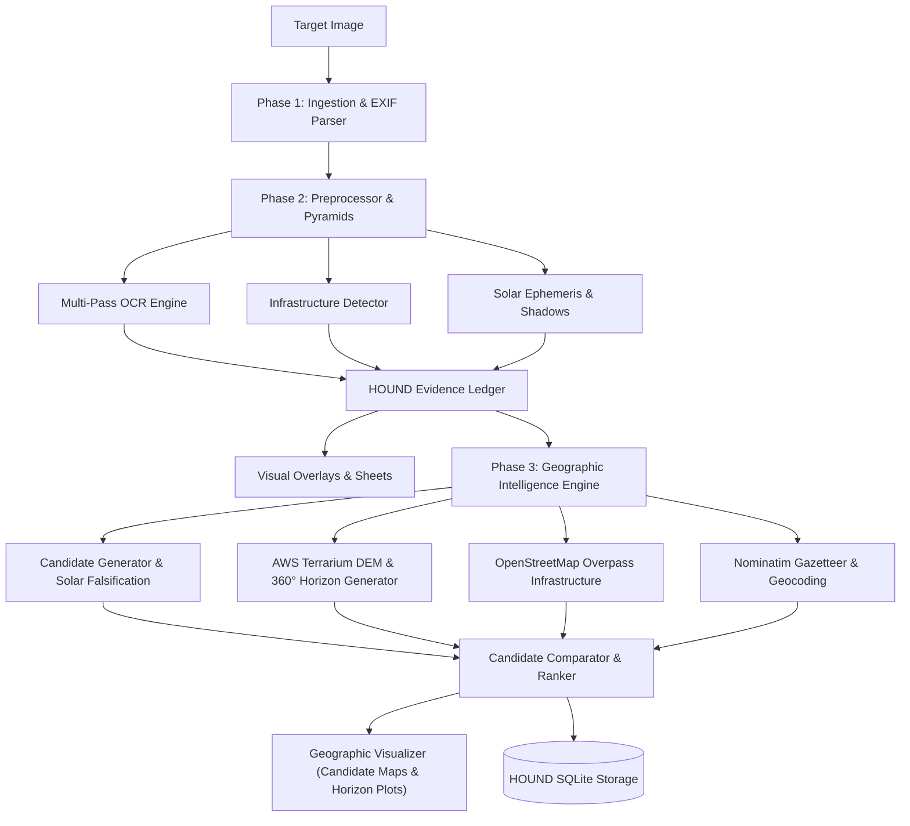

# HOUND — Autonomous Visual Geolocation & OSINT Agent

```text
╔══════════════════════════════════════════╗
║                 H O U N D                ║
║      VISUAL GEOLOCATION INTELLIGENCE     ║
║          EVERY IMAGE LEAVES A TRAIL      ║
╚══════════════════════════════════════════╝
```

**Every image leaves a trail.**

HOUND is an autonomous, evidence-driven visual geolocation and Open-Source Intelligence (OSINT) agent. Designed as an independent, modular forensic investigation system, HOUND analyzes photographs, video frames, and satellite imagery to determine their most probable geographic origins through empirical constraint satisfaction rather than AI guesswork.

---

## Key Capabilities

- **Forensic Image Intake:** SHA-256 cryptographic hashing, non-destructive image preservation, EXIF optics and GPS extraction, and image authenticity/editing assessment.
- **Image Preprocessing:** Generates orientation-normalized analysis copies, contrast-stretched variants, adaptive CLAHE, edge maps, and high-frequency sharpened variants, along with coordinate-mapped crop pyramids.
- **Multi-Pass OCR Engine:** Offline text detection powered by RapidOCR (ONNX Runtime) scanning full-frame, enhanced variants, 2x upscales, and overlapping tiles with spatial IoU deduplication.
- **Geographic Clue Classification:** Automatically categorizes recognized signage into road designations (e.g. `US-101`, `I-80`, `NH 48`), street names, railway stations, transit authorities, phone numbers, and postal codes.
- **Solar & Shadow Geometry:** Solves astronomical solar ephemeris (elevation, azimuth, declination) via NOAA algorithms, extracts candidate cast shadows, and derives latitude and camera heading bounds with explicit uncertainty.
- **Visual Infrastructure Recognition:** Lightweight, CPU-compatible classical computer vision detectors for utility poles, catenary masts, road signboards, and white/yellow lane markings.
- **Geographic Intelligence Engine (OSM & Gazetteer):** Resilient OpenStreetMap Overpass client with mirror failover and persistent SQLite caching; Nominatim forward/reverse geocoding across administrative divisions.
- **Digital Elevation Modeling (DEM):** AWS Terrarium tile decoder with bilinear interpolation, generating 360-degree synthetic terrain horizon profiles incorporating Earth curvature and atmospheric refraction ($k=0.13$).
- **Mountain Ridge Matching:** Cross-correlation ridge matcher solving camera heading (azimuth) and pitch offset by minimizing root-mean-square error (RMSE) against observed visual skylines.
- **Satellite & Map Tile Mosaics:** Provider-independent tile service assembling multi-tile georeferenced mosaics and computing bi-directional geo-to-pixel projections.
- **Candidate Generator & Active Falsification:** Formulates grounded candidate polygons across spatial scales, integrating physical solar feasibility rules that permanently falsify and exclude impossible candidate latitudes.
- **Candidate Comparator & Transparent Ranking:** Mathematically ranks candidate hypotheses using level specificity weights, terrain bonuses, and contradiction penalties.
- **Forensic Evidence Visualizer:** Generates color-coded bounding-box overlays, shadow vector plots, multi-variant comparison sheets, georeferenced candidate maps, and 360° terrain horizon plots.
- **Evidence-Driven State Machine:** Rejects black-box percentage scores in favor of a tiered spatial confidence model (City $\rightarrow$ Area $\rightarrow$ Road $\rightarrow$ Building $\rightarrow$ Pose $\le 10\text{ m}$).

---

## Installation & Setup

### Requirements
- Python 3.10+ (tested on Python 3.13.7)
- Windows, Linux, or macOS

### Install Dependencies
```bash
pip install -r requirements.txt
```

Verify your environment with HOUND's built-in diagnostics:
```bash
python main.py doctor
python main.py geo doctor
```

---

## Command Line Usage

### 1. Geographic Intelligence Investigation
Execute the complete Phase 3 Geographic Intelligence pipeline on an existing visual investigation:
```bash
python main.py geo investigate <investigation_id>
```

### 2. 360-Degree Terrain Horizon Synthesis
Generate a 360-degree synthetic terrain horizon profile from digital elevation models:
```bash
python main.py geo terrain 27.9881 86.9250 --distance-km 15.0 -o everest_horizon.jpg
```

### 3. Geographic Candidate Pool & Ledger
View ranked candidate hypotheses, evidence support, and active falsification conditions:
```bash
python main.py geo candidates <investigation_id>
```

### 4. Candidate Map Generation
Render an annotated geographic map on real map tiles for an investigation's candidate pool:
```bash
python main.py geo map <investigation_id>
```

### 5. Master Visual Intelligence Analysis
Execute the complete Phase 2 visual pipeline (intake, preprocessing, multi-pass OCR, infrastructure detection, shadow analysis, and visual overlays):
```bash
python main.py analyze path/to/image.jpg
```

### 6. Multi-Pass OCR Investigation
Extract visible text, language scripts, and classified geographic clues:
```bash
python main.py ocr path/to/image.jpg
```

### 7. Image Preprocessing & Crop Pyramid Generation
Generate analysis variants (CLAHE, contrast, edge maps, tiles) and coordinate manifest:
```bash
python main.py preprocess path/to/image.jpg
```

### 8. Forensic Metadata Intake
Ingest an image, record its cryptographic hash, and analyze EXIF optics:
```bash
python main.py intake path/to/image.jpg
```

### 9. Deep Metadata Inspection
Inspect all raw EXIF tags and sensor properties:
```bash
python main.py inspect path/to/image.jpg
```

### 10. Investigation History
View all recorded investigations stored in the local SQLite database:
```bash
python main.py list
```

---

## Architecture Overview



For complete architectural details, see:
- [System Architecture](docs/HOUND_ARCHITECTURE.md)
- [Phase 2 Implementation](docs/PHASE_2_IMPLEMENTATION.md)
- [OCR Engine Documentation](docs/OCR_ENGINE.md)
- [Visual Intelligence Specification](docs/VISUAL_INTELLIGENCE.md)
- [Image Preprocessing Guide](docs/IMAGE_PREPROCESSING.md)
- [Development Roadmap](docs/DEVELOPMENT_ROADMAP.md)

---

## Legal & Third-Party Notices

HOUND is an independent software project. Required third-party licenses, algorithm acknowledgments, and open-source copyrights are documented in [THIRD_PARTY_NOTICES.md](THIRD_PARTY_NOTICES.md).
