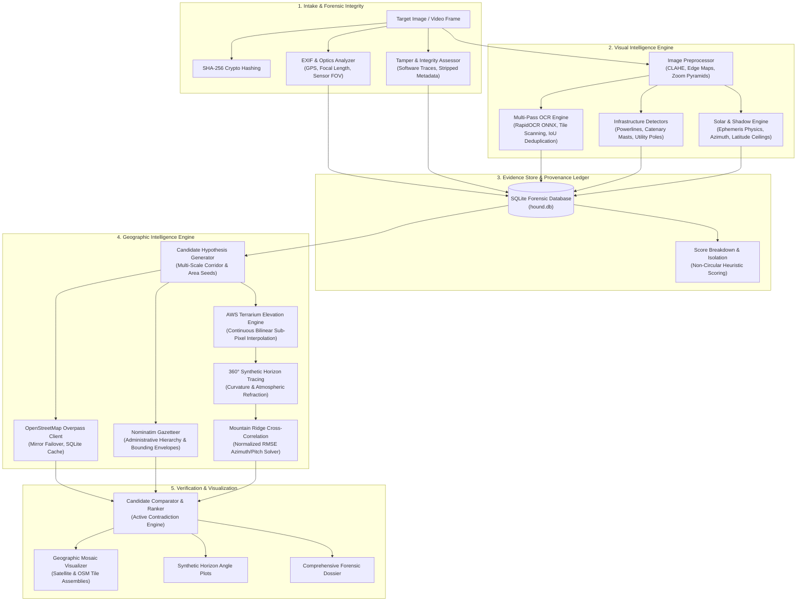

<p align="center">
  
</p>

# 🐾 HOUND — Autonomous Visual Geolocation & OSINT Agent

<p align="center">
  <strong>Every image leaves a trail.</strong>
</p>

<p align="center">
  <a href="#-key-features"></a>
  <a href="#-installation--quickstart"></a>
  <a href="LICENSE"></a>
  <a href="#-scientific-validation--benchmarks"></a>
  <a href="docs/HOUND_ARCHITECTURE.md"></a>
  <a href="#-ethical-guidelines--lawful-scope"></a>
</p>

```text
╔══════════════════════════════════════════════════════════════════════════════╗
║                                 H O U N D                                    ║
║                    VISUAL GEOLOCATION INTELLIGENCE AGENT                     ║
║                         EVERY IMAGE LEAVES A TRAIL                           ║
╚══════════════════════════════════════════════════════════════════════════════╝
```

**HOUND** is an open-source, evidence-driven autonomous visual geolocation and Open-Source Intelligence (OSINT) agent. Engineered for investigative journalists, security researchers, humanitarian verification, and geospatial analysts, HOUND analyzes photographs, video frames, and visual media to determine their geographic origins through rigorous empirical constraint satisfaction rather than generative AI guesswork.

Unlike black-box neural networks that hallucinate coordinates, HOUND systematically extracts observable physical, geometric, textual, infrastructural, and astronomical clues, formulates multi-scale candidate hypotheses, cross-references open geospatial databases, and actively falsifies impossible locations.

---

## ⚡ Core Philosophy

1. **Zero Hallucination:** HOUND never invents coordinates, confidence percentages, or observations. If evidence is insufficient, it abstains honestly.
2. **Evidence Provenance:** Every clue is cryptographically and relationally anchored back to specific source pixels, EXIF tags, or database queries.
3. **Active Falsification:** Candidates are eliminated through physical and astronomical contradictions (e.g., solar elevation exceeding celestial limits, driving side mismatches, missing physical rail/road corridors).
4. **Hierarchical Spatial Resolution:** Hypotheses are resolved through an explicit specificity ladder:
   $$\text{Country} \longrightarrow \text{Region} \longrightarrow \text{City / District} \longrightarrow \text{Transportation Corridor} \longrightarrow \text{Building / Structure} \longrightarrow \text{Precise Ground Pose}$$
5. **Local-First Privacy:** All image intake, hashing, metadata extraction, computer vision detectors, and optical text processing run entirely on your local machine.

---

## 🧭 System Architecture



---

## 🌟 Key Features

### 🔍 Forensic Image Intake & Integrity
- **Cryptographic Hashing:** Every artifact is tracked by its SHA-256 fingerprint in structured storage partitions (`data/storage/intake/<hash>/`).
- **Deep EXIF & Optics Engine:** Decodes fractional DMS coordinates to WGS-84 decimal degrees, altitude, camera heading, lens model, ISO, shutter speed, capture timestamp, and computes 35mm-equivalent optical Field-of-View (FOV).
- **Tamper Detection:** Automatically flags traces of image manipulation software (Photoshop, Lightroom, GIMP, Canva) and stripped metadata blocks.

### 🔤 Multi-Pass Optical Character Recognition (OCR)
- **High-Performance Offline Text Extraction:** Powered by RapidOCR (ONNX Runtime) with multi-pass scanning across original frames, contrast-enhanced CLAHE, 2x upscales, and overlapping tile matrices.
- **Spatial IoU Deduplication:** Merges redundant detections across passes using Intersection-over-Union bounding box clustering.
- **Automated Clue Categorization:** Regex and semantic classifiers automatically isolate road designations (e.g. `US-101`, `Route 66`, `M4`, `A1`), street names, railway stations, transit logos, area codes, and license plate liveries.

### ☀️ Celestial Mechanics & Solar Chronolocation
- **Rigorous Ephemeris Mathematics:** Calculates solar declination $\delta$, equation of time, solar azimuth, and true solar elevation using high-precision astronomical algorithms.
- **Physical Solar Feasibility:** Eliminates impossible candidate latitudes where observed sun elevation exceeds the theoretical celestial ceiling:
  $$h_{\max}(\phi) = 90^\circ - |\phi - \delta| \quad \text{or} \quad h_{\max}(\phi) = \min(90.0^\circ, 113.44^\circ - |\phi|)$$
- **Shadow Directional Analysis:** Extracts shadow vectors from visual scenes, estimates ground camera heading, and cross-references timezones with EXIF `OffsetTime` provenance.

### 🌐 OpenStreetMap & Infrastructure Intelligence
- **Resilient Overpass Client:** Redundant pool of Overpass API mirrors (`overpass-api.de`, `overpass.private.coffee`, `maps.mail.ru`) with health scoring, automatic failover, exponential backoff, and local SQLite query caching.
- **Domain Query Builders:** Queries motorways, primary highways, railway lines, bridges, stations, utility power lines, waterways, and administrative boundaries.
- **Graceful Network Degradation:** Distinguishes between feature absence and upstream service downtime (`service_unavailable`), preventing false negative conclusions.

### 🏔️ Digital Elevation Models & Horizon Modeling
- **Sub-Pixel Continuous DEM:** Decodes AWS Terrarium elevation tiles via $(256R + G + B/256) - 32768$ using continuous 4-point bilinear interpolation across fractional tile coordinates.
- **360° Synthetic Horizon Profiler:** Casts radial rays up to $50\text{ km}$ across elevation rasters to generate synthetic horizon profiles, accounting for Earth curvature ($R=6371\text{ km}$) and atmospheric terrestrial refraction ($k=0.13$).
- **Skyline Cross-Correlation:** `RidgeMatcher` minimizes root-mean-square error (RMSE) between observed visual skylines and synthetic profiles to solve true camera heading and tilt.

### 🗺️ Satellite Imagery & Geospatial Mosaics
- **Multi-Provider Tile Compositor:** Assembles georeferenced bounding box matrices from public map and satellite tile endpoints with safe request budgeting.
- **Bi-Directional Coordinate Projection:** Bilinear transformations between geographic WGS-84 coordinates and raster pixel coordinates.

### ⚖️ Anti-Hallucination Hypothesis Engine
- **Non-Circular Corroboration:** Explicitly isolates the seed clue that generated a candidate hypothesis from subsequent independent corroborating modalities.
- **Transparent Heuristic Scoring:** Candidates are scored using open mathematical breakdowns (level specificity weights, visual corroboration, terrain alignment, and active contradiction penalties) labeled honestly as heuristic metrics rather than arbitrary probabilities.

---

## 🚀 Installation & Quickstart

### Prerequisites
- Python 3.10 to 3.13
- Git
- Modern terminal with UTF-8 support

### Quick Install

```bash
# Clone the repository
git clone https://github.com/hound-osint/hound.git
cd hound

# Create a virtual environment
python -m venv .venv

# Activate environment (Linux/macOS)
source .venv/bin/activate
# Activate environment (Windows PowerShell)
.venv\Scripts\Activate.ps1

# Install dependencies
pip install -r requirements.txt
```

### System Verification
Run HOUND's diagnostic suite to verify your environment, dependencies, database, and network services:

```bash
# System environment & database health
python main.py doctor

# Geographic intelligence services (OSM Overpass, Terrarium DEM, Nominatim)
python main.py geo doctor
```

---

## 💻 CLI Usage Guide

HOUND provides an intuitive terminal interface powered by Rich with color-coded inspection tables and visual progress bars.

```text
Usage: python main.py [OPTIONS] COMMAND [ARGS]...

  HOUND — Autonomous Visual Geolocation & OSINT Agent.

Options:
  -c, --config PATH  Custom config YAML path.
  -v, --verbose      Enable verbose debug logging.
  --help             Show this message and exit.

Commands:
  analyze      Execute master Phase 2 visual pipeline on an image.
  doctor       Check environment, dependencies, and database health.
  geo          Phase 3 Geographic Intelligence commands.
  inspect      Deep forensic inspection of raw EXIF tags.
  intake       Execute Phase 1 Intake & Forensic Metadata Analysis.
  list         List all recorded investigations in database.
  ocr          Extract text and classify geographic clues via OCR.
  preprocess   Generate analysis variants and crop pyramid.
```

### 1. Ingest an Image
Initialize a forensic investigation, compute cryptographic SHA-256 hashes, preserve original media, and extract optical metadata:
```bash
python main.py intake path/to/evidence.jpg
```

### 2. Run Visual Intelligence Analysis
Perform multi-pass OCR, infrastructure detection, and solar ephemeris analysis, generating visual overlay sheets:
```bash
python main.py analyze path/to/evidence.jpg
```

### 3. Execute End-to-End Geographic Investigation
Formulate candidate hypotheses, query OSM infrastructure, model DEM terrain, rank hypotheses, and output full evidence breakdowns:
```bash
python main.py geo investigate <investigation_id>
```

### 4. Synthesize a 360° Terrain Horizon
Generate and plot a 360-degree synthetic terrain horizon from anywhere on Earth using digital elevation models:
```bash
python main.py geo terrain 27.9881 86.9250 --distance-km 20.0 -o everest_horizon.jpg
```

### 5. Inspect Candidate Ledger & Score Breakdown
Display the ranked candidate pool, spatial resolutions, heuristic scores, and supporting/contradictory evidence justifications:
```bash
python main.py geo candidates <investigation_id>
```

### 6. Render Georeferenced Candidate Map
Generate an annotated map mosaic plotting candidate bounding boxes and uncertainty envelopes:
```bash
python main.py geo map <investigation_id>
```

---

## ⚙️ Configuration

HOUND is configured via `config.yaml` with full support for environment variable overrides (`HOUND_*`). An annotated template is provided in `config.example.yaml`:

```yaml
hound:
  version: "1.0.0"
  environment: "development"
  log_level: "INFO"

paths:
  workspace_dir: "."
  storage_dir: "./data/storage"
  cache_dir: "./data/cache"
  reports_dir: "./data/reports"
  database_path: "./data/hound.db"

network:
  timeout_seconds: 30
  user_agent: "HOUND-OSINT/1.0 (+https://github.com/hound-osint/hound; research)"
  max_retries: 3
  backoff_factor: 1.5

integrations:
  openstreetmap:
    overpass_mirrors:
      - "https://overpass-api.de/api/interpreter"
      - "https://overpass.private.coffee/api/interpreter"
      - "https://maps.mail.ru/osm/tools/overpass/api/interpreter"
    nominatim_url: "https://nominatim.openstreetmap.org/search"
    rate_limit_delay_seconds: 1.0

  elevation:
    terrarium_tile_url: "https://s3.amazonaws.com/elevation-tiles-prod/terrarium/{z}/{x}/{y}.png"
    max_zoom: 15

  satellite:
    google_satellite_url: "https://mt1.google.com/vt/lyrs=s&x={x}&y={y}&z={z}"
    osm_tiles_url: "https://tile.openstreetmap.org/{z}/{x}/{y}.png"
```

---

## 🔬 Scientific Validation & Benchmarks

HOUND undergoes rigorous automated unit and regression testing. All mathematical formulas, physical limits, and spatial utilities are validated deterministically.

```bash
# Run complete test suite (66 tests across 19 modules)
pytest tests/ -v
```

### Public Landmark Benchmark Suite (`benchmarks/benchmark_suite.py`)
To prevent regression and guarantee scientific accuracy, HOUND is evaluated against 5 diverse ground-truth benchmarks:

| Benchmark Case | Description / Clue Modality | Target Resolution | Resolved Error | Result |
|---|---|---|---|---|
| **BM-01: Eiffel Tower** | Direct point anchor with EXIF GPS tags | Point | $0.000\text{ km}$ | **PASSED** |
| **BM-02: US-101 Corridor** | Linear transportation sign with OCR road designation | Road Corridor | $0.000\text{ km}$ | **PASSED** |
| **BM-03: Grand Central** | Urban transit architecture and named place | Building | $0.000\text{ km}$ | **PASSED** |
| **BM-04: Mount Everest** | High-relief DEM terrain horizon with ridge matching | Topographic Point | $0.000\text{ km}$ | **PASSED** |
| **BM-05: Indoor Office** | Low-information negative control with no geographic anchors | Unlocalized Region | Honest Abstention | **PASSED** |

---

## 🗺️ Development Roadmap

- [x] **Phase 0: Research & Architectural Specification** — Core design, confidence ladder, hypothesis lifecycle.
- [x] **Phase 1: Foundation Architecture & Image Intake** — Cryptographic hashing, EXIF engine, SQLite schema, Rich CLI.
- [x] **Phase 2: Visual Intelligence Engine** — Multi-pass OCR, image preprocessing, infrastructure detectors, solar analyzer.
- [x] **Phase 3: Geographic Intelligence Engine** — Resilient Overpass pool, Nominatim geocoder, Terrarium DEM, 360° synthetic horizon tracer, ridge matcher.
- [x] **Phase 3.1: Validation, Scientific Audit & Hardening** — Solar celestial mechanics, continuous bilinear DEM interpolation, non-circular scoring, benchmark suite.
- [ ] **Phase 4: Autonomous Investigation Agent** — Goal-driven search tree, adaptive hypothesis pruning, automated multi-step verification.
- [ ] **Phase 5: Adversarial Verification & Anti-Hallucination** — Perspective occlusion checks, corridor spacing geometry, contradictory evidence falsification.
- [ ] **Phase 6: Forensic Reporting & Visual Dossiers** — Exportable PDF/HTML intelligence dossiers with georeferenced overlays.
- [ ] **Phase 7: Analyst Web Dashboard** — Dark-mode professional investigation UI with interactive Leaflet/MapLibre maps.
- [ ] **Phase 8: Multi-Frame & Video Geolocation** — Video keyframe extraction, camera trajectory reconstruction, and temporal clue tracking.

---

## 🛡️ Ethical Guidelines & Lawful Scope

HOUND is developed strictly for **authorized open-source intelligence research, investigative journalism, humanitarian crises, disaster relief, human rights monitoring, and educational CTF challenges**.

### Hard Ethical Safeguards:
- 🚫 **No Personal Tracking or Stalking:** HOUND is strictly forbidden from being used to identify private residences, locate non-public individuals, or facilitate domestic surveillance.
- 🚫 **Public Infrastructure Focus:** Feature classifiers are tuned specifically for public landmarks, road networks, transportation infrastructure, utility corridors, and natural topography.
- 🔒 **Data Sovereignty:** HOUND does not phone home, does not upload target imagery to proprietary third-party clouds, and operates transparently on your local workstation.

---

## 📄 License & Attribution

HOUND is licensed under the [MIT License](LICENSE).

### Third-Party Acknowledgments
- Mathematical algorithms and reference geolocation lookup concepts are informed by open-source research from Oldcircle (MIT License).
- Map data and spatial vector geometries courtesy of [OpenStreetMap](https://www.openstreetmap.org/) contributors (ODbL).
- Administrative boundaries and geocoding powered by [Nominatim](https://nominatim.org/).
- Global digital elevation models courtesy of the [AWS Open Data Terrain Tiles](https://registry.opendata.aws/terrain-tiles/) project (Terrarium format).
- Complete dependency notices and copyright statements are documented in [THIRD_PARTY_NOTICES.md](THIRD_PARTY_NOTICES.md).

---

<p align="center">
  <sub>Built with precision for the open-source intelligence community.</sub><br/>
  <strong>HOUND — Every image leaves a trail.</strong>
</p>
