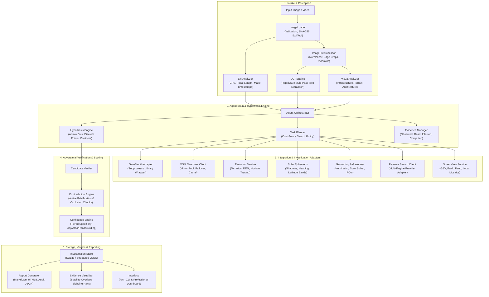

# HOUND — System Architecture Specification

**Project:** HOUND — Autonomous Visual Geolocation & OSINT Agent  
**Document:** System Architecture & Technical Design  
**Version:** 1.0.0  
**Date:** 2026-11-05  

---

## 1. System Vision & Guiding Philosophy

> *"Every image leaves a trail."*

HOUND is an autonomous, evidence-driven visual geolocation and Open-Source Intelligence (OSINT) agent. The core philosophy of HOUND is that **geolocation is an empirical science, not an AI hallucination game**.

Modern vision-language models frequently output plausible-sounding coordinates based on surface-level visual recognition (e.g. guessing "Zurich, Switzerland" because a mountain looks Alpine). HOUND categorically rejects manufactured confidence. A coordinate is not an accepted answer unless it is grounded in verifiable, interlocking geometric and physical constraints:
- Solar azimuth and shadow angles.
- Perspective-n-Point (PnP) camera resectioning.
- Ridge and horizon matching against Digital Elevation Models (DEM).
- Discrete OpenStreetMap (OSM) infrastructure intersections and corridor alignments.
- Verifiable street view or ground-truth imagery inlier matching.

Every candidate hypothesis generated by HOUND is tracked on a formal evidence board, subjected to active falsification attempts by an independent verification engine, and scored using a transparent likelihood-ratio and constraint-satisfaction framework.

---

## 2. Architectural Blueprint



---

## 3. Directory Structure

HOUND is organized into clean, single-responsibility modules:

```text
HOUND/
├── agent/                         # Autonomous Orchestration & Cognition
│   ├── __init__.py
│   ├── orchestrator.py            # Master investigation state machine
│   ├── investigation_manager.py   # Lifecycle, timeouts, budget, and abort handling
│   ├── hypothesis_engine.py       # Candidate tree generation (Country -> Admin -> Point)
│   ├── evidence_manager.py        # Evidence item lifecycle, linking, and likelihood weights
│   ├── confidence_engine.py       # Deterministic, tiered confidence calculator
│   └── task_planner.py            # Optimal next-step selector (cheap-to-expensive ordering)
│
├── investigators/                 # Domain-Specific Analysis Engines
│   ├── __init__.py
│   ├── base.py                    # BaseInvestigator abstract contract
│   ├── metadata/                  # EXIF, camera profiles, timestamp validation
│   ├── ocr/                       # Multi-pass text extraction, language & script detection
│   ├── visual/                    # Architecture, landscape, vehicle livery clues
│   ├── infrastructure/            # Powerlines, railways, catenary masts, utility poles
│   ├── terrain/                   # Skyline extraction, ridge matching, slope calculation
│   ├── shadows/                   # Solar ephemeris, shadow angles, latitude bounds
│   └── landmarks/                 # Distinctive anchors and POI identification
│
├── integrations/                  # External Service Adapters & Tooling
│   ├── __init__.py
│   ├── geo_sleuth/                # Decoupled adapter wrapping Geo-Sleuth scripts
│   │   ├── adapter.py             # Subprocess wrapper with encoding & timeout guards
│   │   └── registry.py            # Geo-Sleuth tool discovery and path resolver
│   ├── openstreetmap/             # Resilient Overpass QL generator & mirror pool
│   ├── geocoding/                 # Nominatim, Gazetteer, and administrative boundaries
│   ├── elevation/                 # Terrarium DEM tile downloader and horizon synthesizer
│   ├── satellite/                 # Satellite imagery tiles and mosaic compositor
│   ├── reverse_image/             # Pluggable reverse search adapter (Lens, Yandex, Bing)
│   └── street_imagery/            # Street-view panorama retrieval (GSV, Baidu)
│
├── verification/                  # Adversarial Verification & Anti-Hallucination
│   ├── __init__.py
│   ├── candidate_verifier.py      # Independent multi-constraint check
│   ├── contradiction_engine.py    # Active falsification (e.g. occlusion & missing features)
│   └── evidence_validation.py     # Rigorous verification of proof artifacts
│
├── core/                          # Fundamental Primitives & Utilities
│   ├── __init__.py
│   ├── image_loader.py            # Image validation, hashing, orientation handling
│   ├── image_preprocessor.py      # Crop generation, zoom pyramids, contrast enhancement
│   ├── geographic_search.py       # Geodesy math, Vincenty, bearings, ray intersection
│   ├── candidate_ranker.py        # Bayesian / Likelihood-ratio candidate ranker
│   └── configuration.py           # YAML / Environment-variable configuration schema
│
├── storage/                       # State Persistence & Audit Logging
│   ├── __init__.py
│   ├── database.py                # SQLite schema and session transactions
│   ├── evidence_store.py          # Evidence ledger and artifact repository
│   └── investigation_store.py     # Complete investigation run serialization
│
├── reports/                       # Human & Machine Deliverables
│   ├── __init__.py
│   ├── report_generator.py        # Forensic markdown, executive summary, JSON export
│   └── evidence_visualizer.py     # Satellite overlay cards with camera heading fans
│
├── interface/                     # User Interaction Endpoints
│   ├── __init__.py
│   ├── cli.py                     # Rich-powered forensic terminal CLI
│   └── dashboard/                 # Dark-mode web interface (FastAPI / HTML5 UI)
│
├── docs/                          # Architectural & OSINT Research Documentation
├── tests/                         # Unit, Integration, and Regression Test Suite
├── config.example.yaml            # Default system configuration
├── requirements.txt               # Pinned Python package dependencies
├── main.py                        # Root entry point
└── DEVELOPMENT_LOG.md             # Continuous chronological development ledger
```

---

## 4. Evidence & Hypothesis Model

### 4.1 Clue Taxonomy & Verification States
Every piece of information acquired during an investigation is instantiated as an `EvidenceItem` with a strictly defined status:

1. **`read`**: Unambiguous text extracted via OCR or readable directly from signs, plates, or documents.
2. **`observed`**: Direct sensory observation (e.g., "dark basalt rock", "four-wire overhead line"). Cannot be used for outright exclusion; can down-weight with likelihood ratio clamped between `0.2` and `5.0`.
3. **`inferred`**: Educated deduction based on heuristics (e.g. "probably an intercity rail line", "temperate autumn climate"). Down-weights with likelihood ratio clamped between `0.33` and `3.0`.
4. **`computed`**: Derived from rigorous mathematical or spatial calculation (e.g., ray intersection, DEM ridge cross-correlation, PnP resection). **Only computed evidence backed by an artifact file can execute hard candidate exclusion.**

### 4.2 Candidate Hypothesis Structure
A candidate represents a spatial hypothesis at any granularity:
- `Country` (e.g., Canada)
- `AdminDivision` (e.g., British Columbia)
- `Municipality` (e.g., Vancouver)
- `Corridor` (e.g., Highway 99 corridor)
- `Point` (Specific latitude/longitude with error radius)

Each candidate tracks:
- Unique identifier and hierarchical parent (`candidate.parent_id`).
- Bounding polygon or point coordinate `(lat, lon)` with uncertainty radius `±r` meters.
- List of supporting evidence IDs with likelihood multipliers.
- List of contradictory evidence IDs.
- Falsification criteria: Specific conditions that, if tested and failed, eliminate the candidate.
- Current cumulative likelihood score and normalized ranking.

---

## 5. Confidence Engine Specification

HOUND avoids subjective confidence percentages (e.g., "I am 87% sure this is in France"). Instead, confidence is strictly **tiered by spatial resolution**:

| Tier Level | Spatial Resolution | Verification Requirements for "High" Confidence |
|---|---|---|
| **City** | Municipality / District | Confirmed text, distinctive vehicle plates, dialing codes, or unique global landmark anchor. |
| **Area** | 1 km to 5 km | Distinctive facility or terrain matching $\ge 3$ invariant top-down features in satellite imagery, with all candidate alternatives in the search region examined and eliminated. |
| **Road** | Street / Segment | Ground-level street view or high-res aerial match on $\ge 2$ unique invariant structures (building contours, pole placements, retaining walls). |
| **Building** | Single Structure / Lot | Intersection of $\ge 2$ independent geometric constraints (e.g. sightline rays + sun azimuth) **and** ground-level verification of $\ge 3$ invariant facade elements. |
| **Camera Pose** | $\le 10$ m accuracy | PnP resection with $\ge 4$ 3D-to-2D correspondences, horizon pitch alignment, and camera height reconciled against DEM elevation. |

If the evidence does not satisfy the criteria for a finer tier, HOUND locks the conclusion to the coarsest verified tier and explicitly outputs:
`STATUS: UNRESOLVED AT ROAD LEVEL — HIGH CONFIDENCE AT MUNICIPALITY LEVEL`.

---

## 6. Verification & Contradiction Engine

The verification engine operates adversarially against the leading hypothesis. Before any location is declared a final result:

1. **Active Falsification:** For the top candidate, the engine searches for features that *should* be visible if the hypothesis were true. If a 200-meter communication tower sits 300 meters north of the candidate camera position, but `geo.py frame` proves the camera FOV points north and no tower exists in the photo, the candidate is penalized or excluded.
2. **Occlusion & Horizon Reconciliation:** Candidate elevation is checked against the scene. If the camera altitude requires a downward pitch angle of $5^\circ$ to see a valley floor, but the horizon in the image indicates level or upward pitch, the position is rejected.
3. **Corridor Uniformity:** Spacing between repetitive infrastructure (e.g., transmission pylons or railway viaduct piers) is re-projected from the candidate coordinates. If the observed pixel ratios do not match the geometric spacing, the candidate is down-weighted.

---

## 7. Geo-Sleuth Adapter Design

Geo-Sleuth will be integrated as an external subsystem via `integrations/geo_sleuth/`:
- **Subprocess Isolation:** Geo-Sleuth scripts will be invoked in controlled subprocesses with strict timeout budgets, UTF-8 environment overrides (`PYTHONUTF8=1`), and proxy support.
- **Artifact Harmonization:** Geo-Sleuth cache (`.geo-cache/`) and output boards (`board.json`) will be mapped seamlessly into HOUND's unified SQLite database and storage structure.
- **Non-Destructive Boundary:** The original Geo-Sleuth directory is treated as read-only upstream code. HOUND will never overwrite or mutate Geo-Sleuth files.

---

## 8. Privacy, Ethics & Sensitive Target Safeguards

HOUND is an OSINT and visual geolocation engineering tool designed for lawful investigations, disaster response, environmental monitoring, verification of open-source conflict footage, and educational CTF research.

HOUND enforces the following hard constraints:
1. **No Target Live-Fire / Stalking:** Features designed to identify a private individual's home address from personal social media portraits without consent are prohibited.
2. **Local-First Processing:** Image hashing, metadata extraction, and local visual transformations run entirely on the local workstation without uploading user images to third-party proprietary AI endpoints unless explicitly authorized by configuration.
3. **Audit Trail:** Every investigation records a tamper-evident audit log with SHA-256 hashes of input media, timestamps, executed queries, and data sources accessed.

---

## 9. Phased Implementation Roadmap

- [x] **Phase 0: Research & Audit** (Geo-Sleuth audit, architecture specification, dependency validation)
- [ ] **Phase 1: Foundation** (Project structure, configuration system, rich CLI, image ingestion, EXIF extraction, SQLite schema, unit tests)
- [ ] **Phase 2: Visual Intelligence** (RapidOCR multi-pass, image preprocessing, edge cropping, solar ephemeris, initial visual analyzer)
- [ ] **Phase 3: Geographic Intelligence** (Resilient Overpass mirror pool, gazetteer, DEM terrain/horizon matching, Geo-Sleuth adapter)
- [ ] **Phase 4: Autonomous Investigation** (Hypothesis engine, candidate board, task planner, evidence manager)
- [ ] **Phase 5: Verification & Anti-Hallucination** (Contradiction engine, occlusion checks, tiered confidence engine)
- [ ] **Phase 6: Reporting & Visuals** (Forensic reports, satellite overlay visualizer, export formats)
- [ ] **Phase 7: Dashboard** (Dark-mode professional analyst web interface)
- [ ] **Phase 8: Multi-Frame & Video Investigation** (Keyframe extraction, persistent visual feature tracking across frames)
