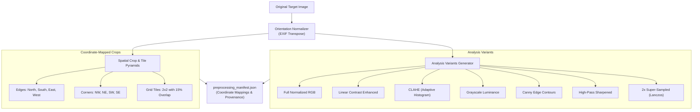

# HOUND — Image Preprocessing Engine

## 1. Overview

The Image Preprocessing Engine (`core/image_preprocessor.py`) generates multi-scale, enhanced, and coordinate-mapped analysis variants from an ingested image without modifying or overwriting the original file.

In visual geolocation, raw photos often exhibit non-uniform illumination, deep shadows, high-frequency camera shake, or small distant signage. HOUND creates a structured set of specialized visual variants and overlapping spatial tiles so downstream investigators (OCR, infrastructure recognition, shadow geometry) operate with maximum feature visibility.

---

## 2. Preprocessing Architecture



---

## 3. Analysis Variants

1. **`full_normalized`:** Orientation-corrected RGB master image using EXIF orientation matrix. Guarantees that image pixel coordinate `(0, 0)` is strictly top-left across all platforms.
2. **`contrast_enhanced`:** Global linear contrast stretch ($1.4\times$ multiplier) for washed-out scenes.
3. **`clahe`:** Contrast Limited Adaptive Histogram Equalization ($2.5$ clip limit, $8\times 8$ grid). Elevates structural details and text hidden in deep shadows or harsh backlit scenes.
4. **`grayscale`:** Single-channel luminance representation reducing chromatic aberration and sensor noise.
5. **`edge_enhanced`:** Inverted Canny edge map highlighting linear infrastructure (poles, viaducts, curbs, utility cables).
6. **`sharpened`:** Convolutional high-pass filter ($3\times 3$ Laplacian kernel) emphasizing high-frequency edges for license plates and distant text.
7. **`upscaled_2x`:** High-precision Lanczos interpolation for photos $\le 2048\text{ px}$. Coordinates detected in this variant are automatically divided by $2.0$ when mapped to the original image frame.

---

## 4. Overlapping Crop and Tile Pyramids

Every tile and edge crop preserves its exact spatial bounding box `(x0, y0, x1, y1)` relative to the original image frame:
- **Edge Crops:** Top 30% (`edge_north`), Bottom 30% (`edge_south`), Left 30% (`edge_west`), Right 30% (`edge_east`).
- **Corner Crops:** $35\% \times 35\%$ quadrants (`corner_nw`, `corner_ne`, `corner_sw`, `corner_se`).
- **Grid Tiles:** $2 \times 2$ grid with $15\%$ spatial padding/overlap. Overlap ensures that signs or features straddling tile boundaries are never bisected or missed.

---

## 5. Preprocessing Manifest

Each run outputs a machine-readable `preprocessing_manifest.json`:
```json
{
  "source_image": "image_001.jpg",
  "original_dimensions": [3000, 2000],
  "normalized_dimensions": [3000, 2000],
  "analysis_variants": [
    {
      "name": "full_normalized",
      "dimensions": [3000, 2000],
      "file_path": ".../variants/image_001_normalized.jpg",
      "description": "Orientation-normalized full resolution RGB image."
    }
  ],
  "crops": [
    {
      "name": "tile_r0_c0",
      "crop_type": "tile",
      "box_original": [0, 0, 1725, 1150],
      "dimensions": [1725, 1150],
      "file_path": ".../crops/image_001_tile_r0_c0.jpg"
    }
  ],
  "processing_time_seconds": 0.28
}
```
