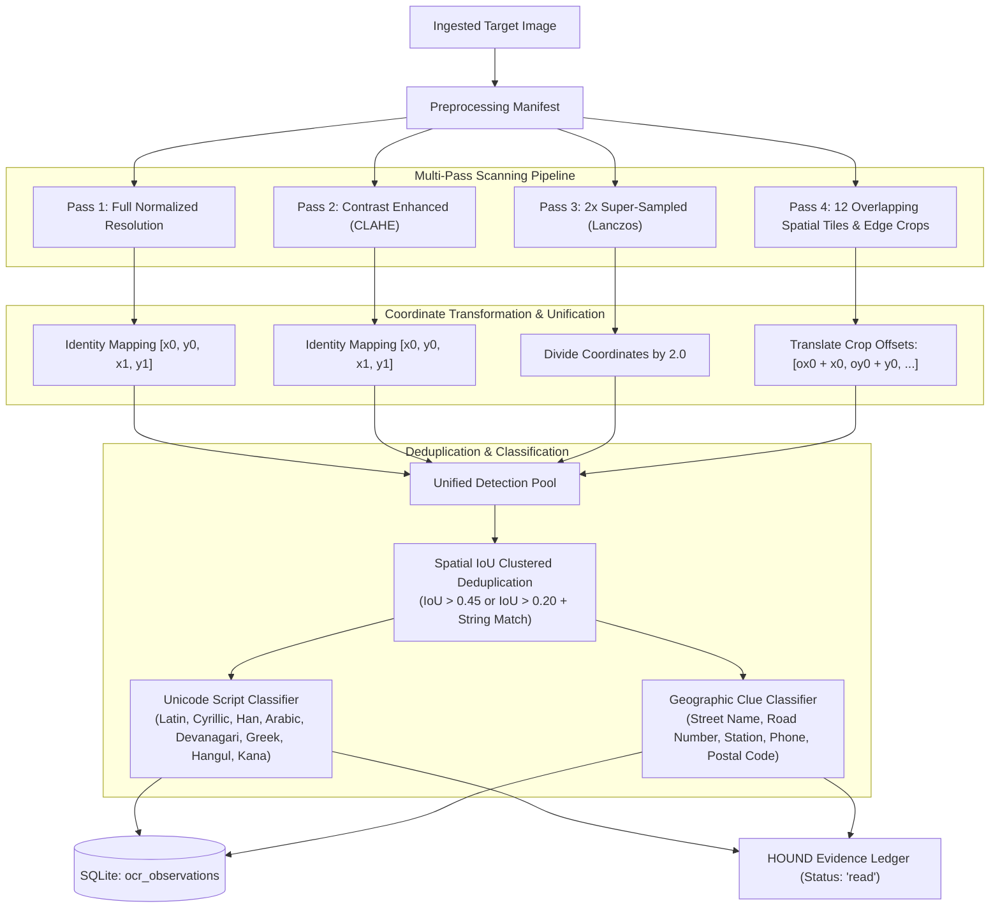

# HOUND — Multi-Pass OCR Investigation Engine

## 1. Overview

The OCR Investigation Engine (`investigators/ocr/ocr_engine.py`) extracts visible text from forensic imagery. Rather than running a single flat OCR pass, HOUND executes a multi-pass strategy across preprocessed variants and coordinate-mapped crop pyramids, translates all detected bounding boxes back to the original image coordinate frame, deduplicates overlaps via spatial Intersection-over-Union (IoU) and string similarity, and classifies recognized text into geographic clue categories.

---

## 2. Multi-Pass Investigation Architecture



---

## 3. Pluggable OCR Backend Architecture

HOUND isolates OCR execution behind an abstract `BaseOCRBackend`:
```python
class BaseOCRBackend(ABC):
    @abstractmethod
    def detect_text(self, image_input: Path | np.ndarray) -> List[RawOCRBox]:
        pass
```
The primary backend is **RapidOCR** (`RapidOCRBackend`), powered by ONNX Runtime with lightweight text detection (DBNet) and text recognition (CRNN/SVTR) models. The backend operates completely offline with zero mandatory cloud API dependencies.

---

## 4. Geographic Clue Classification Catalog

Every recognized text string is analyzed against regex heuristics and international naming patterns:

| Clue Category | Description & Pattern Heuristics | Examples |
|---|---|---|
| **`road_number`** | Highway, interstate, national route, or motorway designation, including optional directional suffixes. | `I-80`, `US-101 North`, `M4`, `A1`, `NH 48`, `G107`, `B402`, `E15` |
| **`street_name`** | Multilingual street/road suffixes, including compound German/Nordic words. | `Main Street`, `Grand Ave`, `Müllerstrasse`, `Rue de Rivoli`, `Avenida Paulista`, `南京东路` |
| **`railway_station`** | Multilingual transit and rail terminus indicators. | `Central Station`, `Hauptbahnhof`, `Gare du Nord`, `Estación Central`, `新宿駅`, `北京南站` |
| **`transport_authority`**| Urban rapid transit, subway, and railway authority branding. | `Metro`, `Subway`, `SNCF`, `DB`, `TfL`, `MTA`, `BART`, `S-Bahn` |
| **`telephone_number`** | Standard international and local telephone dialing sequences. | `+1 (555) 234-5678`, `(02) 9876 5432`, `0800 123 456` |
| **`postal_code`** | Numeric or alphanumeric postal codes. | `90210`, `75008`, `SW1A 1AA`, `K1A 0B1` |
| **`abbreviation`** | 2-3 character capital acronyms. | `FDNY`, `BC`, `CA`, `DHS` |
| **`unknown`** | General descriptive or unclassified signage text. | `Welcome`, `Pharmacy`, `Fresh Bread` |

---

## 5. Spatial & Textual Deduplication

Because text may be detected across multiple passes (e.g. visible both in the full image and inside `tile_r0_c0`), HOUND clusters detections:
1. Sorts raw detections by descending model confidence.
2. For each detection, calculates spatial IoU against existing clusters:
   - If $\text{IoU} > 0.45$, the boxes refer to the same physical text sign.
   - If $\text{IoU} > 0.20$ and normalized strings match, they are merged.
3. Retains the highest-confidence reading and records `passes_detected` (e.g. `["full_normalized", "tile_r0_c0"]`).

---

## 6. Evidence Provenance & Storage

Observations are persisted to the SQLite `ocr_observations` table:
- `investigation_id`, `text`, `confidence`, `box_x0`, `box_y0`, `box_x1`, `box_y1`, `category`, `language_script`, `pass_name`.
- Formally emitted into the HOUND Evidence Ledger as `EvidenceItem` with status **`read`**. Text is strictly treated as an observation, not an assumed location proof.
