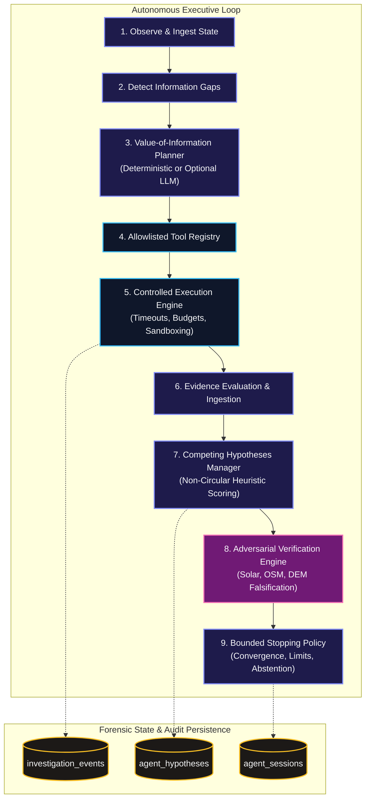

# HOUND — Phase 4: Autonomous Investigation & Multi-Modal Verification Engine

**Date:** 2026-11-12  
**Status:** Implemented & Verified  
**Architecture Layer:** Agent Reasoning, Tool Orchestration & Adversarial Falsification  

---

## 1. Executive Summary

Phase 4 elevates HOUND from an evidence extraction and candidate generation toolkit into an autonomous, self-directed forensic investigation agent. 

Rather than executing a hardcoded sequence of scripts, HOUND's Phase 4 engine operates through a **controlled observe-plan-execute-evaluate loop**. The agent inspects available evidence, identifies critical information gaps, computes the expected Value of Information (VOI) for available allowlisted tools, formulates competing geographic hypotheses across spatial scales, actively attempts to disprove leading candidates through adversarial verification, and enforces strict bounded execution and honest abstention policies.

---

## 2. Component Architecture



### Module Inventory

1. **`agent/agent_models.py`:**
   - Defines strongly-typed Pydantic schemas for `InvestigationAction`, `ToolResult`, `InvestigationEvent`, `HypothesisRecord`, `VerificationQuestion`, and `FinalInvestigationDossier`.
2. **`agent/investigation_state.py`:**
   - Encapsulates live investigation state, budget counters (iterations, tool calls, external requests, elapsed time), clue detection flags, action deduplication signatures, and database persistence/resumption methods.
3. **`agent/tool_registry.py`:**
   - Allowlisted, schema-validated tool catalog exposing 14 stable capabilities across visual, geographic, evidence, and verification domains. Prohibits arbitrary shell or Python execution.
4. **`agent/planner.py`:**
   - Dynamic action prioritizer evaluating expected uncertainty reduction $\Delta U$, source reliability $R$, evidence independence $I$, falsification potential $F$, and execution cost $C$:
     $$\text{Priority} = \frac{\Delta U \cdot R \cdot I \cdot F}{C + 0.1}$$
5. **`agent/hypothesis_manager.py`:**
   - Manages competing hypotheses across their lifecycle (`proposed` $\rightarrow$ `active` $\rightarrow$ `supported` / `challenged` $\rightarrow$ `rejected` / `inconclusive`).
   - Strictly enforces non-circular scoring: seed clues are excluded from independent corroboration points.
   - Preserves all rejected hypotheses with explicit recorded reasons (never drops inconvenient evidence).
6. **`agent/verification_engine.py`:**
   - Actively formulates falsification challenges across solar feasibility ceilings, OSM corridor presence, and DEM horizon correlation.
   - Distinguishes missing data and service outages (`service_unavailable`) from genuine physical contradictions.
7. **`agent/stopping_policy.py`:**
   - Bounded execution engine evaluating stopping criteria: sufficient evidence, budget exhaustion, path exhaustion, indistinguishable candidates, and honest abstention on low-information controls.
8. **`agent/llm_provider.py`:**
   - Pluggable LLM reasoning interface supporting OpenAI, Gemini, and generic OpenAI-compatible HTTP endpoints with structured JSON schemas and guaranteed offline fallback.
9. **`agent/investigation_agent.py`:**
   - Master orchestrator managing the controlled execution loop, event logging, session serialization, and final dossier compilation.

---

## 3. Tool Registry Catalog

| Tool Identifier | Domain | Purpose | External Network? |
|---|---|---|---|
| `metadata_exif` | Visual | Extracts EXIF optics, camera make/model, timestamps, and embedded GPS. | No |
| `image_preprocessing` | Visual | Generates CLAHE contrast, edge maps, and multi-scale tile pyramids. | No |
| `ocr_extraction` | Visual | Multi-pass RapidOCR scanning for road codes, highway signs, transit hubs. | No |
| `infrastructure_detection`| Visual | Detects overhead catenary masts, power transmission poles, lane markings. | No |
| `solar_shadow` | Visual | Calculates NOAA solar ephemeris, extracts cast shadow vectors. | No |
| `candidate_generation` | Geographic | Synthesizes visual clues into multi-scale candidate hypotheses. | No (Offline resilient) |
| `osm_road_search` | Geographic | Queries Overpass mirrors for highway network geometry. | Yes (Cache fallback) |
| `osm_infrastructure_search`| Geographic | Queries Overpass for railway tracks, catenary, and utility corridors. | Yes (Cache fallback) |
| `gazetteer_search` | Geographic | Resolves place names and administrative boundaries via Nominatim. | Yes (Cache fallback) |
| `dem_horizon_profile` | Geographic | Computes 360° synthetic terrain horizons from AWS Terrarium DEM rasters. | Yes (Cache fallback) |
| `ridge_matching` | Geographic | Cross-correlates observed skylines with synthetic DEM horizons. | No |
| `candidate_comparison` | Evidence | Ranks candidate hypotheses using level weights and contradiction factors. | No |
| `adversarial_solar_check` | Verification| Falsifies candidates whose latitude violates maximum solar ceilings. | No |
| `adversarial_osm_check` | Verification| Checks whether expected physical corridors actually exist in candidate area. | Yes (Cache fallback) |

---

## 4. Controlled Investigation Loop

Each investigation loop executes under strict stateful governance:

```text
OBSERVE
  ↓
UPDATE INVESTIGATION STATE
  ↓
EVALUATE CURRENT EVIDENCE
  ↓
IDENTIFY INFORMATION GAPS
  ↓
SELECT NEXT ACTION (Planner / Optional LLM)
  ↓
EXECUTE APPROVED TOOL (Allowlisted Sandbox)
  ↓
VALIDATE TOOL RESULT
  ↓
RECORD EVIDENCE (Cryptographic Ledger)
  ↓
UPDATE HYPOTHESES (Non-Circular Scoring)
  ↓
SEARCH FOR CONTRADICTIONS (Adversarial Verification)
  ↓
CONTINUE OR STOP (Stopping Policy)
```

---

## 5. End-to-End Benchmark Scenarios

Verified in [`tests/test_agent_scenarios.py`](file:///d:/project/Hound/tests/test_agent_scenarios.py):

### Scenario A: Strong Multi-Modal Evidence Convergence
- **Inputs:** Visual photograph containing high-contrast highway sign (`US-101 NORTH / CA COAST`), solar ephemeris clue ($42.1^\circ$), and coastal mountain skyline.
- **Agent Behavior:**
  1. Inspects image metadata and generates analysis variants.
  2. Runs OCR and detects road designation `US-101`.
  3. Formulates multi-scale candidate hypotheses (Corridor `US-101 North`, `California`).
  4. Runs solar feasibility test verifying candidate latitude $35^\circ\text{N}$ satisfies ceiling $h_{\max} = 78.1^\circ$.
  5. Computes DEM horizon profile and confirms coastal ridge presence.
- **Outcome:** Primary hypothesis `Corridor: US-101 North` supported with high heuristic score ($>20.0$), zero contradictions, and final status `localized` or `region_identified`.

### Scenario B: Conflicting Candidates & Solar Falsification
- **Inputs:** High observed solar elevation ($65.0^\circ$ noon sun) with ambiguous signage (`Route 1`).
- **Initial Candidates:** Arctic Norway ($70^\circ\text{N}$) vs. California ($35^\circ\text{N}$).
- **Agent Behavior:**
  1. Identifies conflicting candidate locations.
  2. Formulates adversarial solar verification question for Arctic Norway:
     $$h_{\max}(70^\circ) = \min(90^\circ, 113.44^\circ - 70^\circ) = 43.44^\circ$$
  3. Evaluates observed $65.0^\circ > 43.44^\circ + 3.0^\circ$ tolerance $\longrightarrow$ **PHYSICALLY IMPOSSIBLE**.
  4. Transitions `Route 1 (Finnmark, Norway)` to `rejected` with recorded reason: `"Violates solar ceiling (65.0° > 43.44° at lat 70.00°)"`.
  5. Evaluates California ($35^\circ\text{N}$ ceiling $78.44^\circ$) $\longrightarrow$ **FEASIBLE**.
- **Outcome:** Leading hypothesis updated to `Route 1 (California, USA)`, rejected hypothesis preserved in audit trail.

### Scenario C: Weak Evidence & Honest Abstention (Negative Control)
- **Inputs:** Featureless indoor office space without EXIF GPS, readable signage, or terrain skylines.
- **Agent Behavior:**
  1. Executes metadata analysis: no GPS coordinates found.
  2. Executes image preprocessing and multi-pass OCR: zero geographic text detected.
  3. Executes infrastructure detection and solar analysis: no unique anchors.
  4. Stopping policy evaluates evidence state: no geographic anchors found.
- **Outcome:** Agent halts honestly with `final_status="insufficient_evidence"`, `stopping_reason="insufficient_evidence"`, precision `"Unlocalized"`, and provides structured abstention justifications.

---

## 6. CLI Command Suite

```bash
# Execute autonomous investigation with bounded limits
hound agent investigate <investigation_id> --max-iterations 15 --offline

# Inspect live telemetry, iterations, and budget consumption
hound agent status <investigation_id>

# View competing hypotheses, scores, and rejection justifications
hound agent hypotheses <investigation_id>

# Display chronological event timeline
hound agent history <investigation_id>

# Generate and view targeted adversarial verification questions
hound agent verify <investigation_id>

# Export comprehensive investigation dossier in Markdown format
hound agent report <investigation_id> -o dossier.md
```

---

## 7. Test Suite Verification

- **Automated Tests:** **81 passed, 0 failures, 0 errors in 41.13s** across 22 test modules.
- **New Phase 4 Unit Tests:** 15 dedicated tests covering architecture, tool execution, state persistence, stopping rules, and the 3 end-to-end scenarios.
